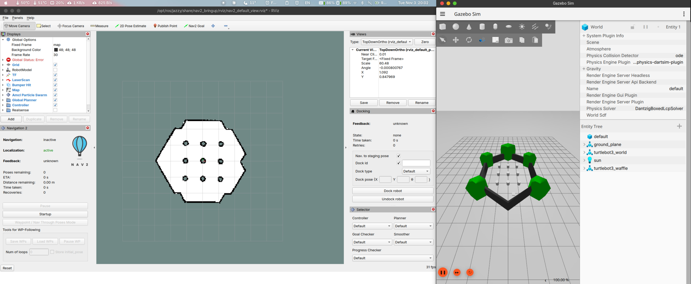
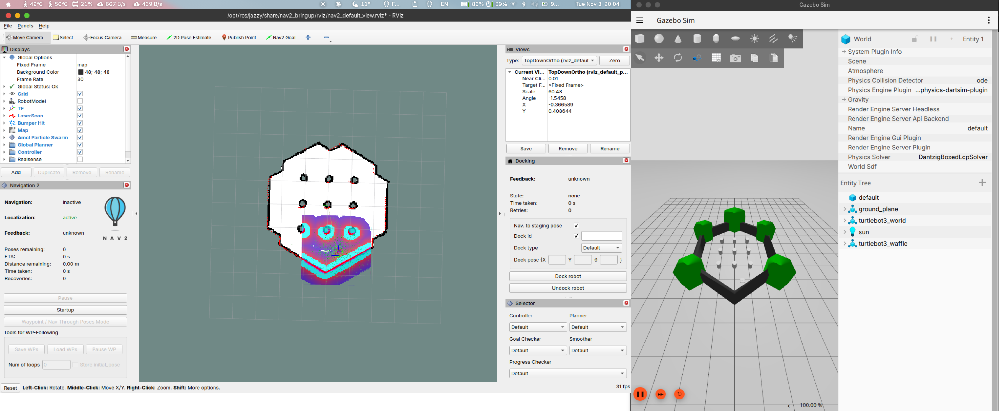
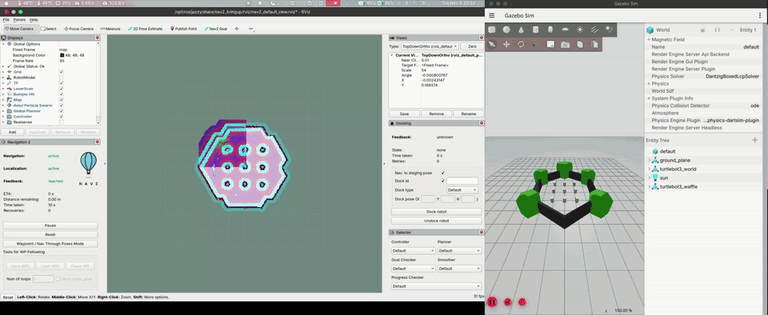

# HW1 — 실습 1: 기본 내비게이션

> 작성자: 이규환

## 과제 1
+ 기본 내비게이션 실행
```bash
~/nav2_edu_ws/scripts/lab1_basic.sh
```
+ 처음 켜면 Global Status: Error, Navigation: inactive 상태다. 초기 위치를 안 줘서 그런 거라 정상이다.
+ 
+ RViz 상단의 2D Pose Estimate를 누르고 로봇 위치(약 x=-2.0, y=-0.5)를 찍은 뒤 오른쪽으로 드래그했다.
+ 초기 위치를 주니까 Global Status가 Ok로 바뀌고, 레이저 스캔(빨간 점)이 벽이랑 겹치고 로봇 주변에 파티클이 생겼다.
+ 
+ Nav2 Goal로 목표 지점을 찍으면 경로가 생기고 로봇이 이동한다. 드래그하면 도착했을 때 바라보는 방향도 정할 수 있다.
+ 
+ 원본 영상: [lab1_3.mp4](video/lab1_3.mp4)
+ 움직이면서 파티클 구름이 점점 작아지는 것도 볼 수 있었다.
