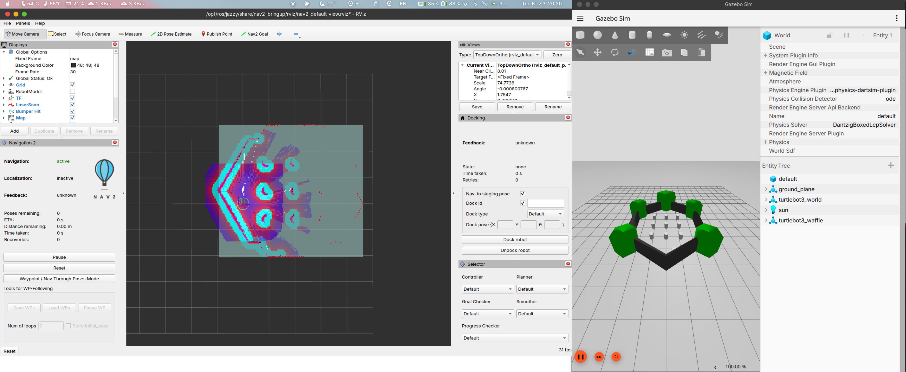
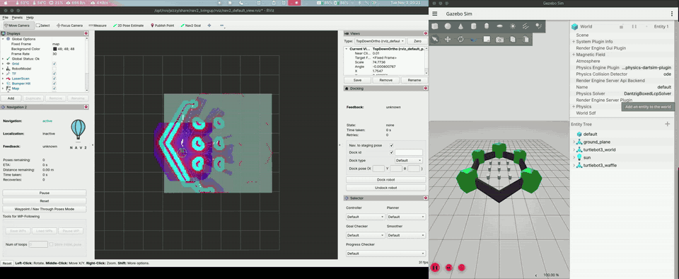
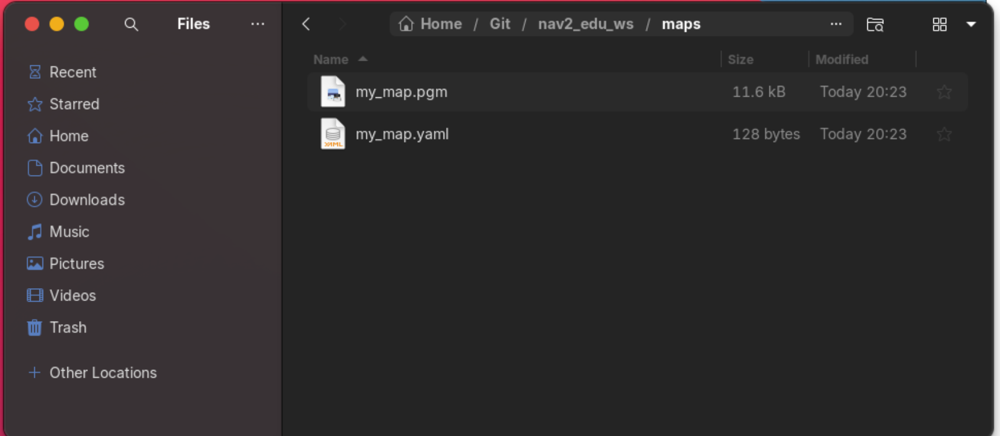
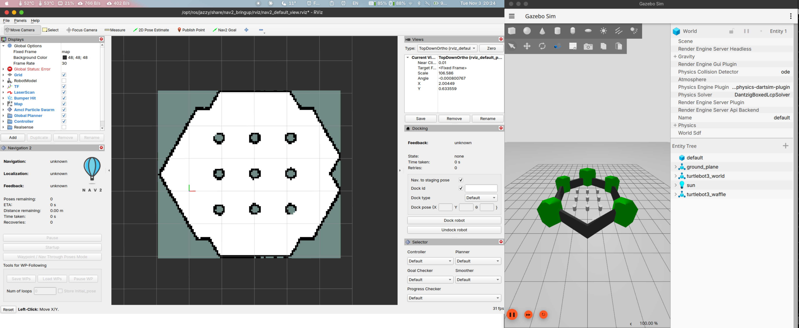
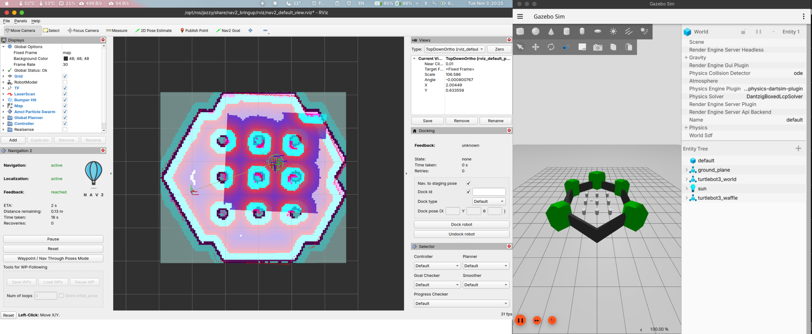

# HW2 — 실습 2: SLAM (지도 만들기)

> 작성자: 이규환

## 과제 2
+ SLAM : 지도 만들기
+ 맵 없이 실행
```bash
~/nav2_edu_ws/scripts/lab2_slam.sh
```
+ slam_toolbox가 지도를 실시간으로 만든다. 초기 위치는 안 찍어도 된다.
+ 
+ Nav2 Goal로 회색(미탐색) 영역 근처를 찍으면서 돌아다니면 지도가 넓어진다. 키보드로 운전해도 된다.
```bash
source /opt/ros/jazzy/setup.bash && source ~/nav2_edu_ws/scripts/edu_env.sh
ros2 run teleop_twist_keyboard teleop_twist_keyboard
```
+ 
+ 원본 영상: [lab2_2.mp4](video/lab2_2.mp4)
+ 탐색을 다 하고 lab2는 켜 둔 채로 새 터미널에서 지도를 저장했다.
```bash
source /opt/ros/jazzy/setup.bash && source ~/nav2_edu_ws/scripts/edu_env.sh
ros2 run nav2_map_server map_saver_cli -f ~/nav2_edu_ws/maps/my_map
```
+ 저장하면 my_map.yaml과 my_map.pgm이 생긴다.
+ 
+ 저장한 지도로 다시 실행
```bash
~/nav2_edu_ws/scripts/lab1_basic.sh map:=$HOME/nav2_edu_ws/maps/my_map.yaml
```
+ 초기 위치 찍기 전에는 Error가 뜬다.
+ 
+ 2D Pose Estimate 후 Nav2 Goal로 이동하니 잘 도착했다(reached, Recoveries 0).
+ 
