# HW3 — 실습 3: 파라미터 튜닝

> 작성자: 이규환

## 과제 3
+ 파라미터 튜닝
+ 실행 명령어
```bash
~/nav2_edu_ws/scripts/lab3_params.sh
```
+ `~/nav2_edu_ws/params/nav2_params.yaml`을 수정하고 껐다 켜서 비교했다.
+ 기본값 (MPPI, inflation_radius 0.70)
+ 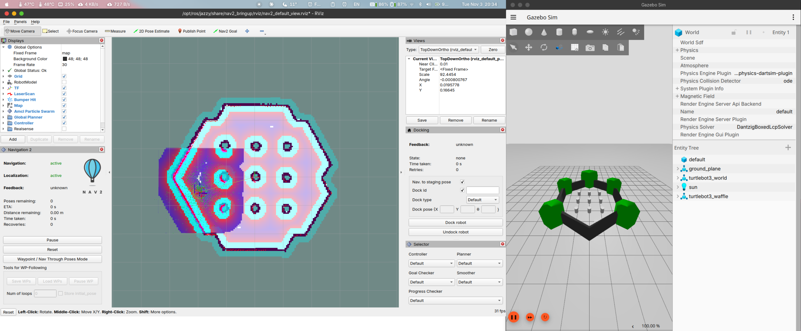
+ 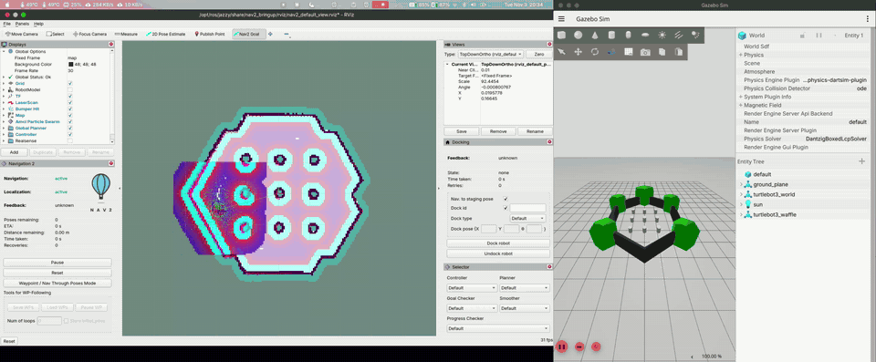
+ inflation_radius 0.30
+ 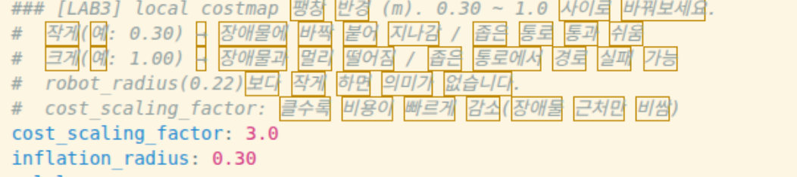
+ 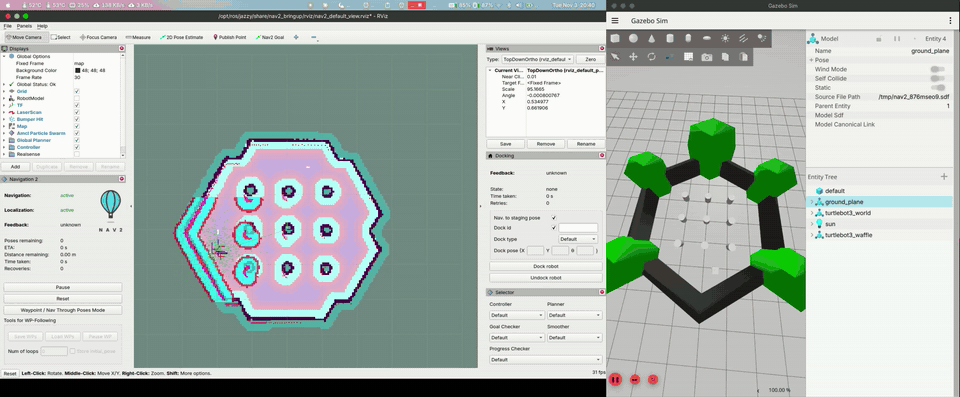
+ 기둥 주변 띠가 얇아지고 로봇이 기둥에 더 붙어서 지나간다.
+ inflation_radius 1.00
+ 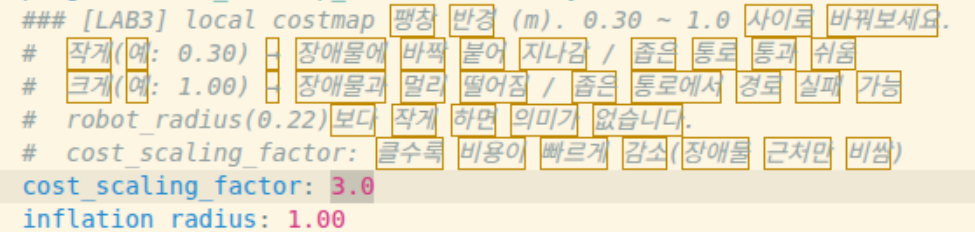
+ 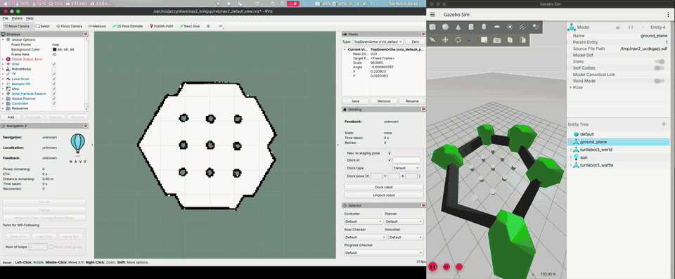
+ 기둥 사이 띠가 서로 겹쳐서 기둥 사이보다 바깥쪽으로 돌아가려고 한다.
+ 실행 중에 `ros2 param set`으로 0.3, 0.7로도 바꿔 봤다.
```bash
ros2 param set /global_costmap/global_costmap inflation_layer.inflation_radius 0.3
ros2 param set /local_costmap/local_costmap inflation_layer.inflation_radius 0.3
```
+ cost_scaling_factor 10.0 (추가로 해 봄)
+ 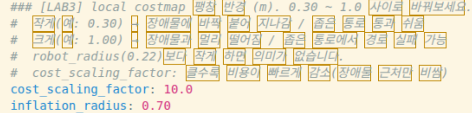
+ 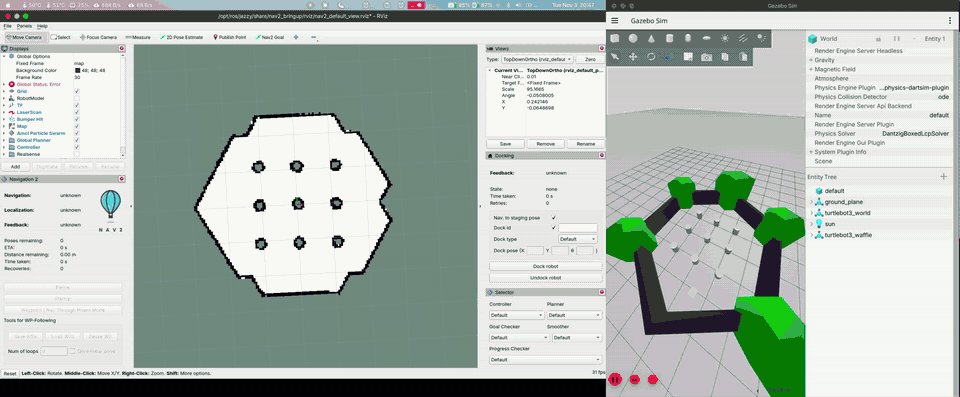
+ 기둥 바로 근처만 비용이 높아져서 0.30일 때처럼 기둥 사이로 잘 지나간다.
+ RPP 주행
+ 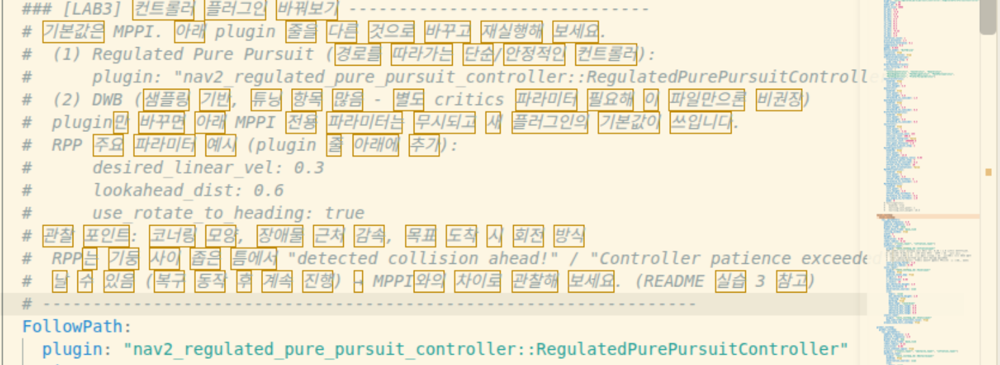
+ 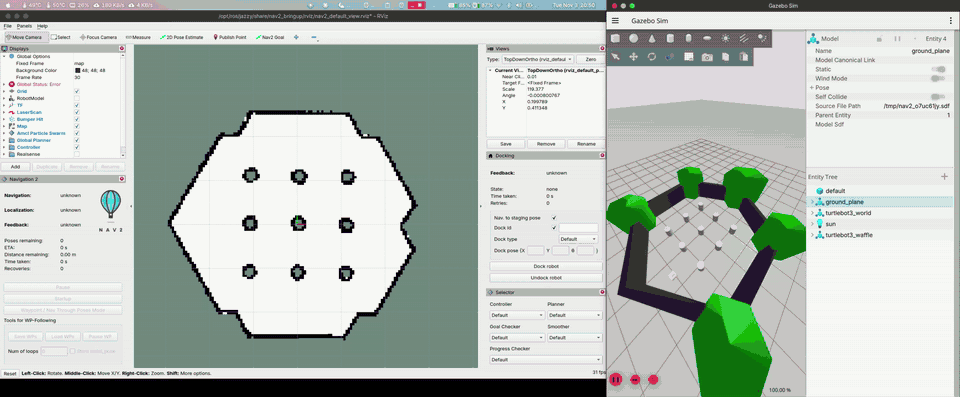
+ Nav2 Goal로 기둥 사이 좁은 곳을 찍었더니 Recoveries가 15까지 올라가다가 결국 aborted 됐다.
+ RPP 상태로 lab4 웨이포인트 주행
+ 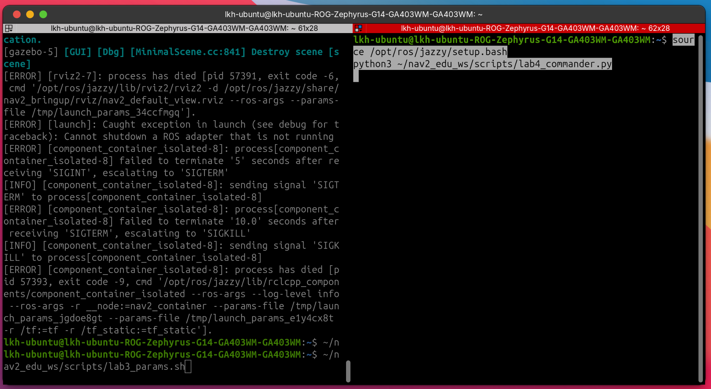
+ 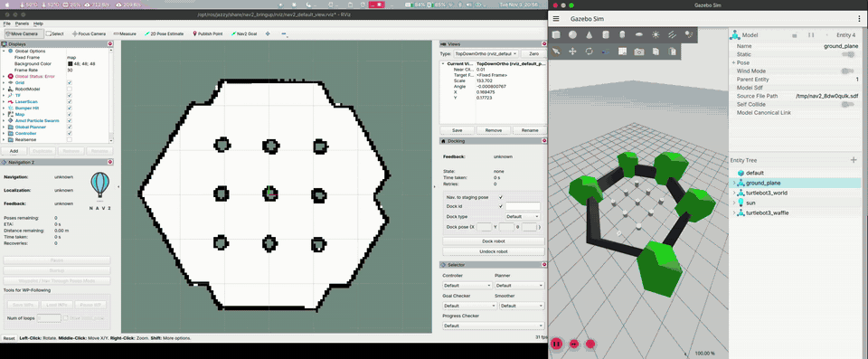
+ RPP 로그
+ 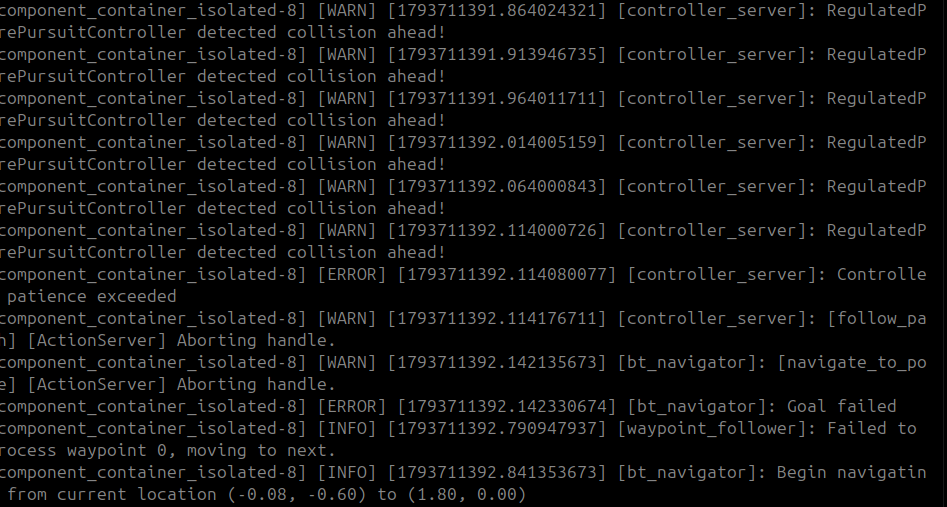
+ 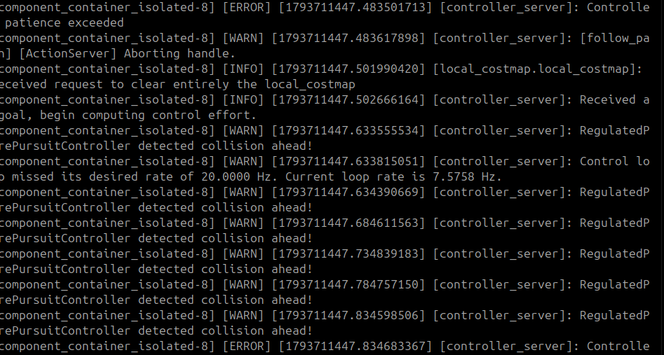
+ `RegulatedPurePursuitController detected collision ahead!` 경고와 `[ERROR] Controller patience exceeded`가 계속 나왔다. local costmap을 비우고 다시 시도해도 또 같은 경고가 났다.
+ 1번 웨이포인트는 Goal failed가 나서 `Failed to process waypoint 0, moving to next.`가 뜨고 2번으로 넘어갔다. 영상만 보면 성공한 것처럼 보인다.
+ MPPI로 할 때는 이런 경고가 한 번도 안 나왔다.
+ 원본 영상: [lab3_2](video/lab3_2.mp4) · [lab3_4](video/lab3_4.mp4) · [lab3_6](video/lab3_6.mp4) · [lab3_8](video/lab3_8.mp4) · [lab3_10](video/lab3_10.mp4) · [lab3_12](video/lab3_12.mp4)
