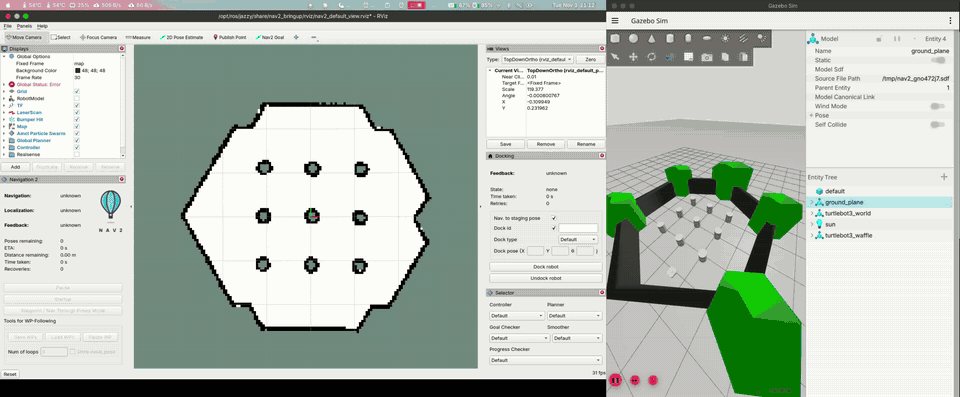

# HW4 — 실습 4: Python으로 웨이포인트 순회

> 작성자: 이규환

## 과제 4
+ python으로 웨이포인트 순회하기
```bash
# 터미널 1
~/nav2_edu_ws/scripts/lab1_basic.sh
# 터미널 2 (lab1이 다 뜬 뒤)
source /opt/ros/jazzy/setup.bash
python3 ~/nav2_edu_ws/scripts/lab4_commander.py
```
+ 초기 위치는 스크립트가 알아서 (-2.0, -0.5, 0.0)으로 잡아 준다.
+ (0.5, -1.5), (1.8, 0.0), (0.5, 1.8) 순서로 이동
+ 
+ 원본 영상: [lab4_1.mp4](video/lab4_1.mp4)
+ 터미널 출력
```
[lab4] 초기 위치 설정: (-2.0, -0.5, 0.0)
[lab4] Nav2 활성화 완료
[lab4] 웨이포인트 1/3 (0.5, -1.5) 로 이동 중...
[lab4] 웨이포인트 2/3 (1.8, 0.0) 로 이동 중...
[lab4] 웨이포인트 3/3 (0.5, 1.8) 로 이동 중...
[lab4] 결과: 성공 - 모든 웨이포인트 순회 완료
```
+ 웨이포인트 3개를 다 돌고 성공으로 끝났다.
