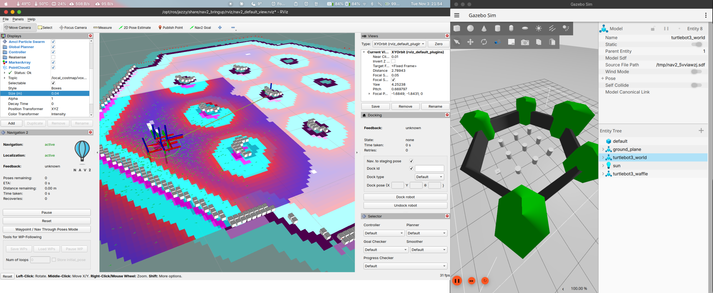
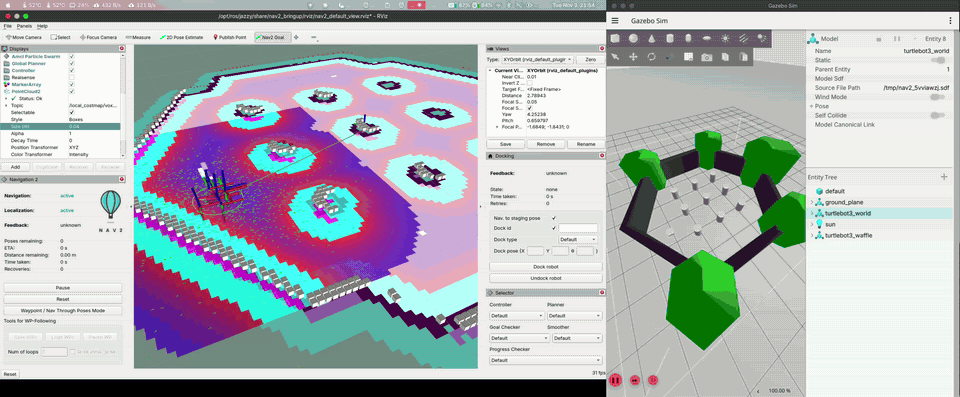
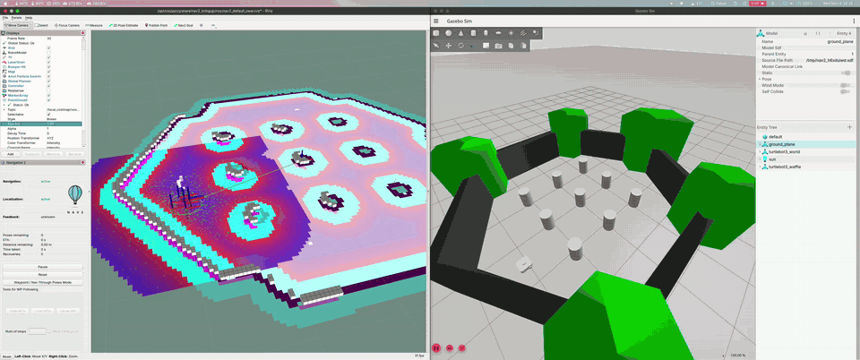
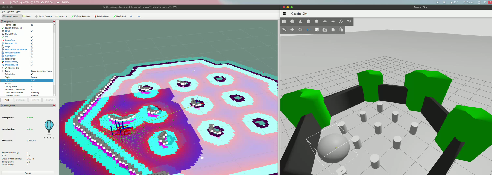
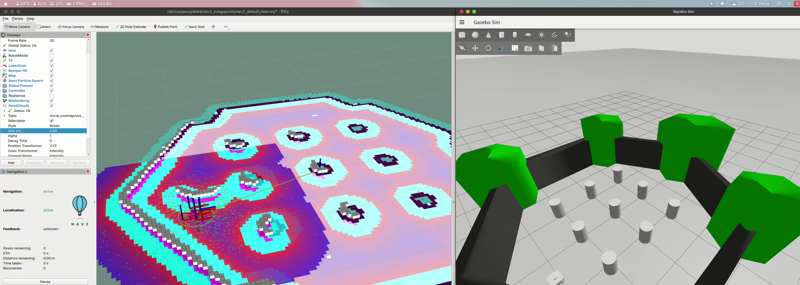
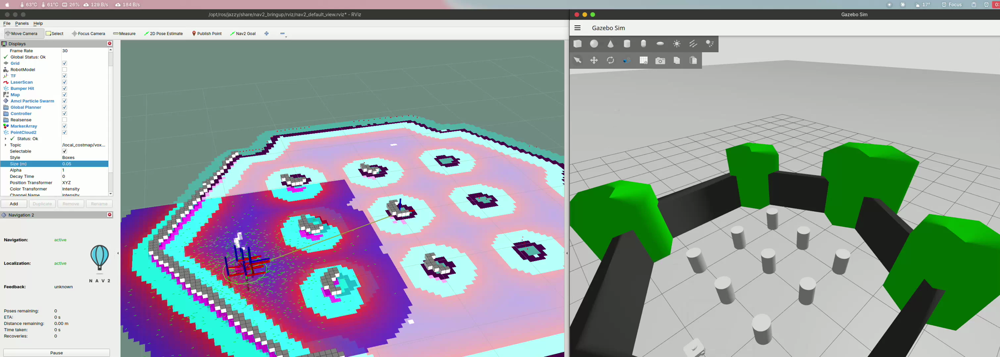

# HW5 — 실습 5: STVL

> 작성자: 이규환

## 과제 5
+ STVL
+ 실행 명령어
```bash
~/nav2_edu_ws/scripts/lab5_stvl.sh
```
+ RViz에서 Add → By topic → `/local_costmap/voxel_grid`를 추가하면 복셀이 보인다.
+ 
+ 라이다가 2D라서 복셀이 한 층만 쌓인다.
+ 
+ 원본 영상: [lab5_2.mp4](video/lab5_2.mp4)
+ Gazebo에서 로봇 앞에 물체를 놓았다가 치워 봤다. (voxel_decay 5.0)
+ 
+ 원본 영상: [lab5_3.mp4](video/lab5_3.mp4)
+ 구를 놓으면 그 자리에 복셀이 생긴다.
+ 
+ Gazebo에서 구를 지워도 RViz에는 바로 안 사라지고 남아 있다.
+ 
+ 6초 정도 지나니까 사라졌다.
+ 
+ yaml 파일의 `voxel_decay` 값으로 장애물을 치웠을 때 맵에서 사라지는 데 걸리는 시간을 조절할 수 있다.
