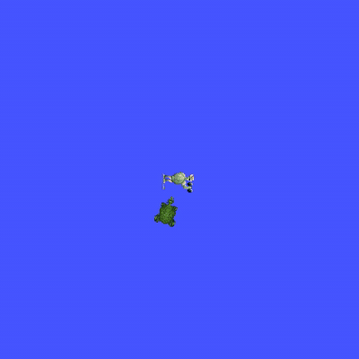
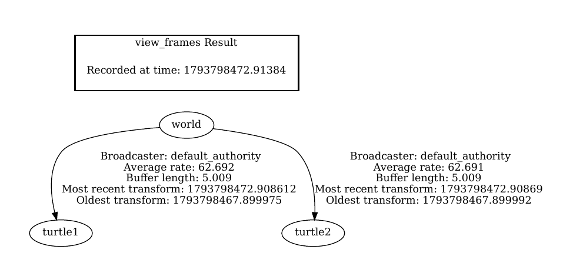
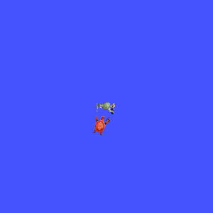
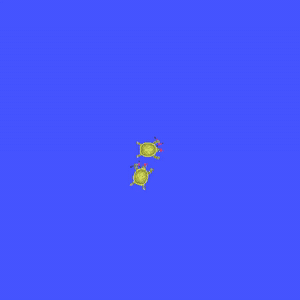
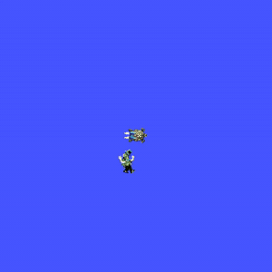
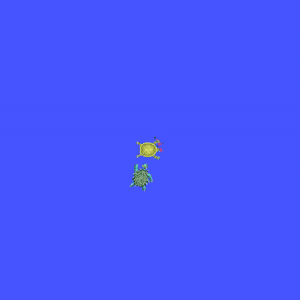
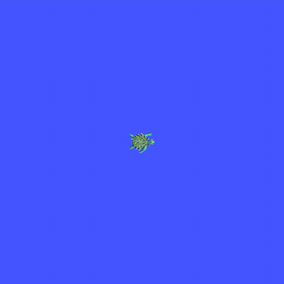

# Day2_hw1

이규환 2026406017

---

## 1. 과제

+ launch 하나로 turtlesim, pose_broadcaster 2개, turtle_follower 실행
+ turtle1 을 움직이면 turtle2 가 TF 로 따라오기
+ 따라가기 계수를 YAML 로 조절
+ rotator(액션)로 turtle1 을 돌려도 turtle2 가 계속 따라오기

solution 에는 k_ang, k_lin 만 있어서 파라미터를 더 추가했다.

+ max_lin_vel, max_ang_vel : 속도 상한
+ stop_distance : 이 거리 안이면 멈춤 (turtle1 이랑 안 겹치게)
+ control_rate : 제어 주기
+ spawn_x, spawn_y, spawn_theta : turtle2 생성 위치

```bash
cd ~/Git/Robit_intelligence_advancedRos2/day_2/hw1
colcon build --symlink-install && source install/setup.bash
ros2 launch turtle_mini follow.launch.py
ros2 run turtlesim turtle_teleop_key
```

## 2. 결과

### 2.1 따라가기

+ launch 하나로 노드 4개가 뜨고 turtle2 가 (4, 2) 에 생성돼서 turtle1 을 따라간다.
```
$ ros2 node list
/broadcaster1
/broadcaster2
/sim
/turtle_follower
```
+ 
+ 원본 영상: [follow_base.mp4](video/follow_base.mp4)
+ 멈췄을 때 turtle2 기준 turtle1 위치. stop_distance 1.0 만큼 떨어져서 멈췄다.
```
$ ros2 run tf2_ros tf2_echo turtle2 turtle1
- Translation: [1.013, -0.000, 0.000]
```

### 2.2 TF 트리

+ world 아래에 turtle1, turtle2 가 붙어 있다.
+ 

### 2.3 파라미터 바꿔 보기

+ 계수는 config/follow_params.yaml 에서 바꾼다. launch 할 때 이 파일을 읽는다.
```yaml
turtle_follower:
  ros__parameters:
    k_ang: 4.0
    k_lin: 0.5
    max_lin_vel: 2.0
    max_ang_vel: 3.0
    stop_distance: 1.0
```
+ 파라미터별 변화를 비교하려고 teleop 키 입력을 저장해 두고 똑같이 재생하는 매크로를 따로 만들었다. 같은 키 입력으로 turtle1 을 움직이고 파라미터만 하나씩 바꿔 봤다.
```bash
ros2 param set /turtle_follower k_ang 1.0
python3 teleop_macro.py play keys.json
```
+ 흰 선이 turtle1, 빨간 선이 turtle2 경로이다.

| 바꾼 값 | |
| --- | --- |
| 기본 (k_ang 4, k_lin 0.5) |  |
| k_ang 1.0 |  |
| k_lin 1.5 |  |
| stop_distance 3.0 |  |
| max_lin_vel 1.0 |  |

+ 원본 영상: [기본](video/follow_base.mp4), [k_ang](video/follow_k_ang.mp4), [k_lin](video/follow_k_lin.mp4), [stop_distance](video/follow_stop_distance.mp4), [max_lin_vel](video/follow_max_lin_vel.mp4)
+ ros2 param set 으로 바꾸면 다시 실행 안 해도 바로 적용된다. 이상한 값이나 생성 위치처럼 실행 중에 바꾸면 안 되는 값은 막았다.
```
$ ros2 param set /turtle_follower k_ang -1.0
Setting parameter failed: k_ang 값이 잘못됨: -1.0

$ ros2 param set /turtle_follower spawn_x 9.0
Setting parameter failed: Trying to set a read-only parameter: spawn_x.
```

### 2.4 액션이랑 같이

+ use_rotator:=true 로 실행하면 3초 뒤에 rotator 가 turtle1 을 3.14 rad 돌린다. 도는 동안에도 turtle2 는 계속 따라온다.
```bash
ros2 launch turtle_mini follow.launch.py use_rotator:=true
```
+ 
+ 원본 영상: [action_rotator.mp4](video/action_rotator.mp4)
```
[rotator]: goal 전송: turtle1 theta=3.140
[rotator]: goal 수락됨
[rotator]: feedback: remaining=3.140
...
[rotator]: result: delta=-3.136
```

## 3. 설명

+ pose_broadcaster : /turtleN/pose 를 받아서 world → turtleN TF 로 보낸다. 같은 실행파일을 이름만 바꿔서 2개 띄웠다.
+ turtle_follower : lookup_transform('turtle2', 'turtle1') 로 turtle2 기준 turtle1 위치 (x, y) 를 받아서 회전은 k_ang * atan2(y, x), 직진은 k_lin * (거리 - stop_distance) 로 계산하고 상한을 넘지 않게 자른다.
+ solution 은 거리 전체에 k_lin 을 곱해서 turtle2 가 turtle1 위로 올라가 겹쳤는데, stop_distance 를 빼서 그 거리에서 멈추게 했다.
+ launch 에 use_rotator, params_file 인자를 만들어서 rotator 를 켜고 끄거나 YAML 을 바꿔 끼울 수 있게 했다.
