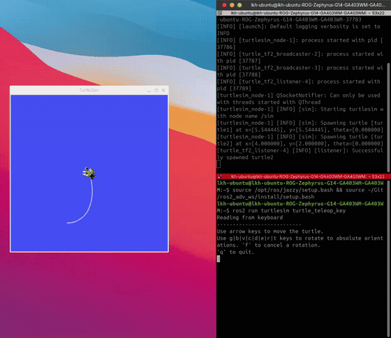
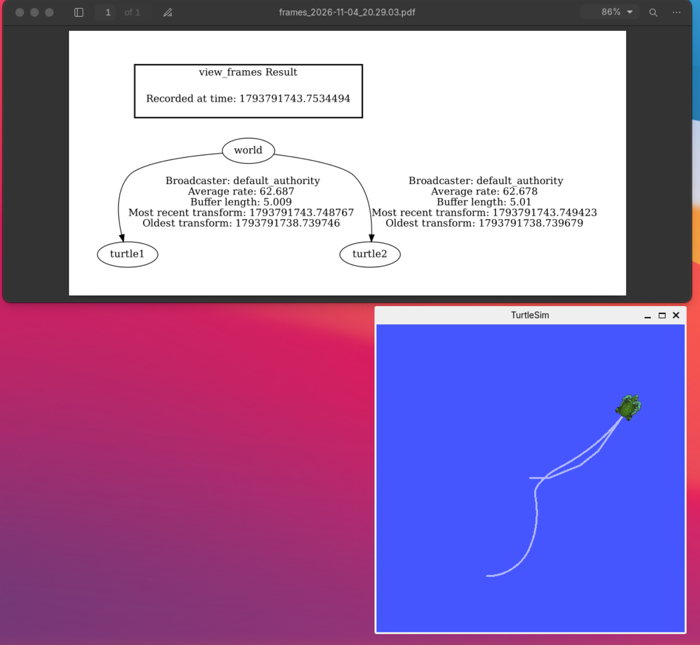
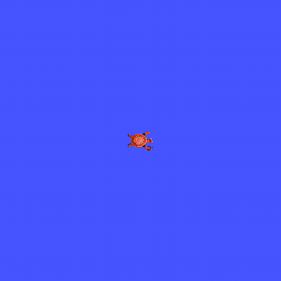
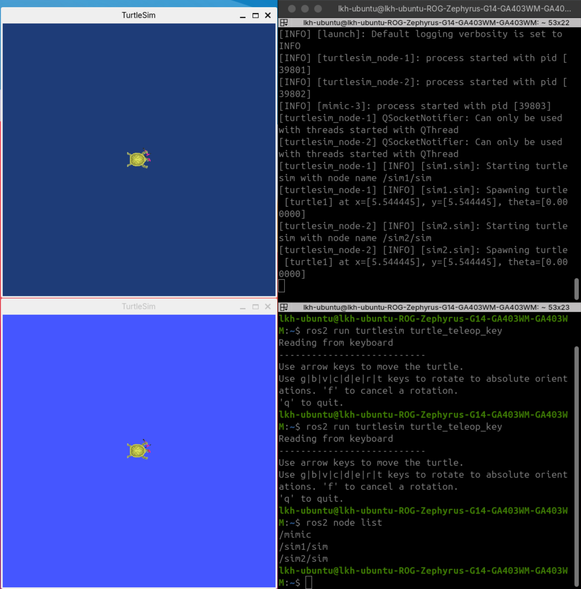
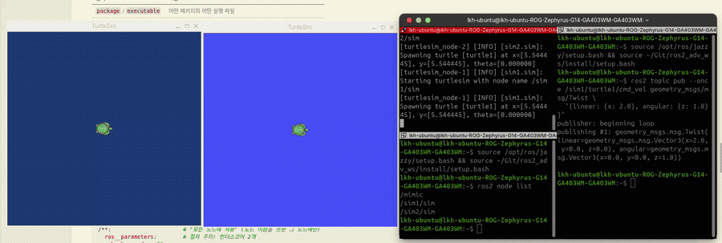
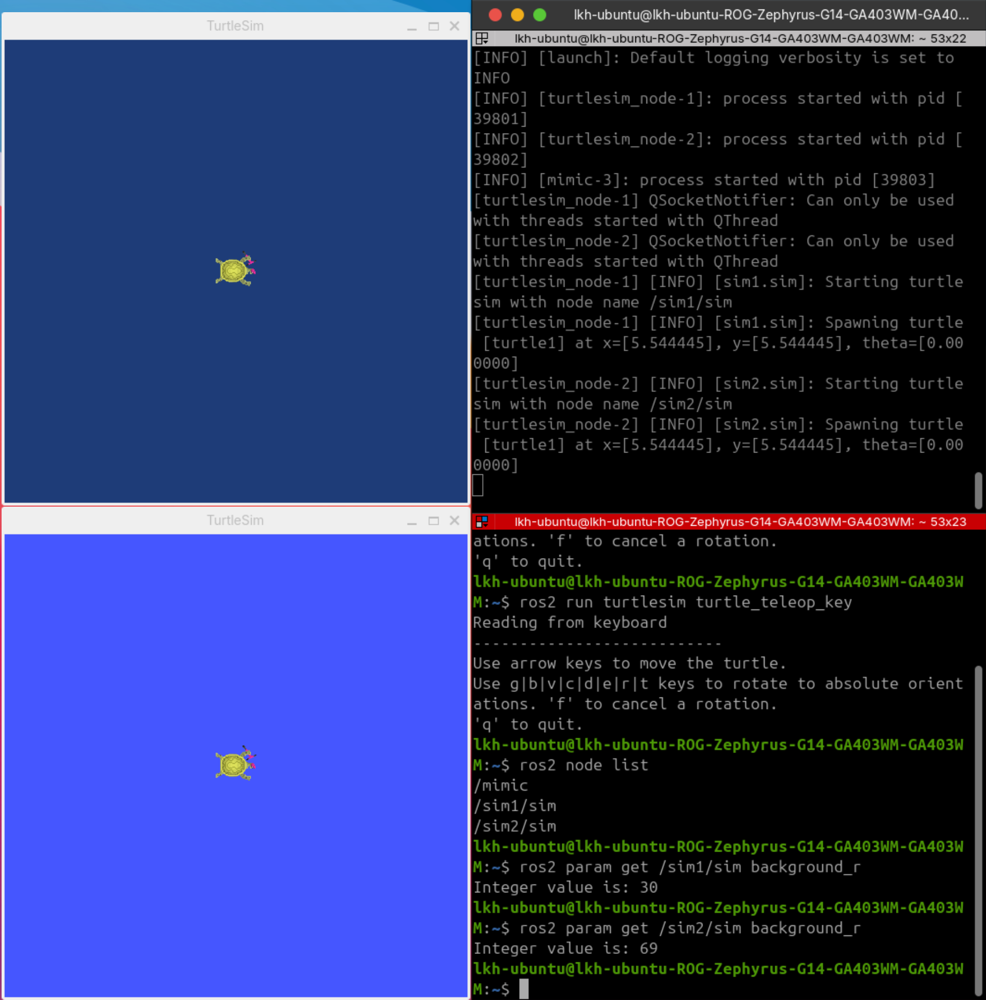
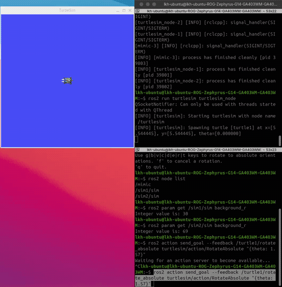
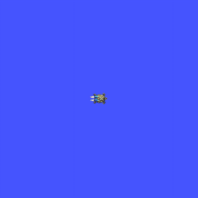

# Day2 TF2, Launch, Action

이규환 2026406017

---

## 1. 개요

심화 2일차에 turtlesim 으로 TF2, Launch, Action 을 실습했다. 어제 Nav2 에서 본 TF 트리, 한 번에 뜨던 노드들, Nav2 Goal 이 어떻게 동작하는지 turtlesim 예제를 실행해 보며 이해했다.

+ TF2 : 좌표계 사이 관계를 트리로 관리하고 변환을 자동으로 계산해 준다
+ Launch : 여러 노드를 명령 하나로 실행하고 namespace, remapping, 파라미터를 같이 설정한다
+ Action : 오래 걸리는 일을 맡길 때 목표를 보내고, 진행 상황을 받고, 결과를 받는다

## 2. 실습

```bash
source /opt/ros/jazzy/setup.bash && source ~/Git/ros2_adv_ws/install/setup.bash
```

### 2.1 TF2

```bash
ros2 launch turtle_tf2_py turtle_tf2_demo.launch.py
ros2 run turtlesim turtle_teleop_key
ros2 run tf2_tools view_frames
```

+ turtle1 을 키보드로 움직이면 turtle2 가 따라온다.
+ 
+ 원본 영상: [tf_follow.mp4](video/tf_follow.mp4)
+ view_frames 결과 world 아래에 turtle1, turtle2 가 연결되어 있다.
+ 

직접 만든 노드(pose_broadcaster)로 world → turtle1 TF 를 발행하고 tf2_echo 로 확인했다.

```bash
ros2 run turtlesim turtlesim_node
ros2 run turtle_adv pose_broadcaster
ros2 run tf2_ros tf2_echo world turtle1
ros2 run turtlesim turtle_teleop_key
```

+ 시작 위치 (5.544, 5.544) 에서 거북이를 움직이니 값이 바뀌었다.
```
- Translation: [5.544, 5.544, 0.000]   (시작)
- Translation: [8.311, 3.581, 0.000]   (움직인 뒤)
```
+ 
+ 원본 영상: [tf_mynode.mp4](video/tf_mynode.mp4)

### 2.2 Launch

```bash
ros2 launch turtle_adv multisim.launch.py
ros2 topic pub --once /sim1/turtle1/cmd_vel geometry_msgs/msg/Twist \
  "{linear: {x: 2.0}, angular: {z: 1.8}}"
ros2 param get /sim1/sim background_r
ros2 param get /sim2/sim background_r
```

+ sim1, sim2, mimic 세 노드가 한 번에 뜬다.
+ 
+ sim1 에만 명령을 보내도 mimic 때문에 sim2 가 똑같이 움직인다.
+ 
+ 원본 영상: [launch_mimic.mp4](video/launch_mimic.mp4)
+ background_r 이 YAML 을 넣은 sim1 은 30, 기본값인 sim2 는 69 이다.
+ 

### 2.3 Action

```bash
ros2 run turtlesim turtlesim_node
ros2 action send_goal --feedback /turtle1/rotate_absolute \
  turtlesim/action/RotateAbsolute "{theta: 1.57}"
```

+ 거북이가 도는 동안 남은 각도(remaining)가 feedback 으로 계속 들어오면서 0 에 가까워진다.
+ 
+ 원본 영상: [action_goal.mp4](video/action_goal.mp4)

직접 만든 액션 클라이언트(rotator)로 목표를 보내고, 다음에는 목표를 보낸 뒤 중간에 취소해 봤다.

```bash
ros2 run turtle_adv rotator --ros-args -p theta:=-3.0
```

+ 서버를 기다리고, 목표를 보내고, feedback 을 받다가 result 를 받으면 스스로 종료된다.
```
[rotator]: goal 전송: theta=-3.000
[rotator]: goal 수락됨
[rotator]: feedback: remaining=-3.000
...
[rotator]: result: delta=2.992
```
+ 중간에 취소하면 다 돌지 않고 멈추고 CANCELED 로 끝난다.
```
goal 전송: theta=0.0
goal 수락됨
cancel 요청
Goal finished with status: CANCELED
```
+ 
+ 원본 영상: [action_rotator.mp4](video/action_rotator.mp4)

## 3. 이해한 내용

### 3.1 TF2

로봇에는 map, base_link, LiDAR, 카메라처럼 좌표계가 여러 개 있고, 센서 값은 그 센서 기준이다. LiDAR 가 정면 2 m 에 장애물을 봤다고 해도 지도에서 어디인지는 따로 계산해야 한다.

+ LiDAR 기준 (2.0, 0)
+ LiDAR 가 로봇 중심에서 0.2 m 앞에 있으니 base_link 기준 (2.2, 0)
+ 로봇이 지도에서 (3, 1) 에 90° 돌아 있으니 회전하면 (0, 2.2), 이동하면 map 기준 (3.0, 3.2)

이 계산을 매 순간 해 주는 게 TF2 이다. 어제 Nav2 costmap 에 LiDAR 점이 지도 위 제자리에 찍힌 것도 TF2 덕분이다.

변환 하나는 회전 + 이동이고, 행렬로 묶으면 여러 단계를 곱해서 이어 붙일 수 있다. T_A_B 는 B 를 A 기준으로 나타낸 변환이다.

```
p_부모 = R(θ) · p_자식 + t
T_map_lidar = T_map_base · T_base_lidar
```

회전은 각도 대신 쿼터니언 (x, y, z, w) 로 저장한다. 각도는 적용 순서에 따라 결과가 달라지고 짐벌 락 문제가 있기 때문이다. 평면에서 yaw 만 돌 때는 z = sin(θ/2), w = cos(θ/2) 이고, 회전이 없으면 (0, 0, 0, 1) 이다.

좌표계는 트리로 연결된다. 부모는 하나, 고리는 없어야 하고, 연결이 끊기면 계산할 수 없다. turtle1 과 turtle2 는 직접 연결되어 있지 않지만 둘 다 world 에 붙어 있어서 TF2 가 world 를 거쳐 둘 사이를 계산해 준다. 그래서 각 노드는 자기 위치만 발행하면 된다.

+ Static TF : 센서 장착 위치처럼 안 변하는 관계. /tf_static 으로 한 번만 발행
+ Dynamic TF : 로봇 위치처럼 계속 변하는 관계. /tf 로 계속 발행

lookup_transform(target, source) 는 target 기준으로 source 가 어디 있는지 묻는다. turtle2 가 따라가야 하니까 ('turtle2', 'turtle1') 순서이고, 반대로 쓰면 역변환이 나와서 엉뚱하게 움직인다. 받은 (x, y) 로 atan2(y, x) 만큼 돌고 거리만큼 직진하면 따라가기가 된다.

### 3.2 Launch

어제 Nav2 를 켰을 때 맵 서버, AMCL, 플래너, 컨트롤러 등 노드 수십 개가 명령 한 줄로 떴다. launch 파일은 어떤 노드를 어떤 이름과 설정으로 띄울지 파이썬 파일 하나에 적어 둔 것이다.

+ namespace : 같은 노드를 두 번 띄우면 이름이 겹치는데, /sim1, /sim2 를 붙여서 나눈다. 로봇 여러 대를 띄울 때도 이렇게 한다.
+ remapping : 코드를 안 고치고 토픽 이름만 바꿔 연결한다. mimic 의 입력을 sim1, 출력을 sim2 에 연결해서 sim2 가 sim1 을 따라 움직였다.
+ YAML 파라미터 : 코드를 안 고치고 설정을 바꾼다. /** 는 모든 노드, 노드 이름을 쓰면 그 노드에만 적용된다. Nav2 도 속도, costmap 크기 같은 값을 다 YAML 로 관리한다.

ros2 launch 는 install 의 share 폴더에서 파일을 찾기 때문에 launch 나 YAML 파일을 새로 추가하면 다시 빌드해야 한다.

### 3.3 Action

+ 토픽 : 계속 보내고 응답이 없다. 센서 값, 속도 명령
+ 서비스 : 요청 한 번에 응답 한 번. 짧게 끝나는 일
+ 액션 : 목표를 보내면 중간 상황(feedback)을 계속 받고 마지막에 결과(result)를 받는다. 중간에 취소도 된다. 오래 걸리는 일

몇십 초 걸리는 일을 서비스로 만들면 그동안 아무것도 못 듣고 멈추게 할 수도 없다. 그래서 이동 같은 일은 액션으로 만든다.

액션 인터페이스는 --- 로 나뉜 Goal, Result, Feedback 세 칸이다. RotateAbsolute 는 theta(목표 각도), delta(실제로 돈 양), remaining(남은 각도) 이다.

클라이언트는 서버를 기다리고, 목표를 보내고, 수락됐는지 확인하고, 결과를 기다리는 순서로 동작한다. 목표 수락과 결과 두 번을 비동기로 기다린다.

어제 RViz 에서 Nav2 Goal 을 찍은 것도 navigate_to_pose 액션에 목표를 보낸 것이었다. 가는 동안 남은 거리가 feedback 으로 오고, 도착하면 result 가 온다. 오늘 거북이를 돌린 것과 같은 구조이다.

## 4. 터틀봇 프로젝트 돌아보기

이전에 했던 터틀봇 자율주행 프로젝트에 오늘 배운 걸 적용했으면 더 좋았을 것 같은 부분이다.

### 4.1 TF2

+ stm_bridge 에 엔코더로 odom → base_link TF 를 발행하는 기능이 있었는데 꺼 두고(publish_tf: false) 썼다. 켜 뒀으면 RViz 에서 로봇이 간 경로를 바로 볼 수 있어서 주행이나 주차 디버깅이 쉬웠을 것이다.
+ 카메라 높이(252 mm)와 피치(40.2°)가 bird_eye_view.yaml 에만 숫자로 들어가 있었고 grid_drive 도 같은 값을 따로 맞춰야 했다. base_link → camera 를 Static TF 로 발행했으면 한 곳만 고치면 됐을 것이다.

```bash
ros2 run tf2_ros static_transform_publisher --z 0.252 --pitch 0.7016 \
  --frame-id base_link --child-frame-id camera
```

### 4.2 Launch

+ bringup launch 로 카메라, 비전, stm_bridge 를 묶고 노드마다 YAML 을 나눈 건 잘한 부분이었다.

### 4.3 Action

+ task_planner 가 control_mode 토픽으로 주차 모드를 알리고, 주차가 끝났는지는 mission_state 문자열을 보고 따로 판단했다. 토픽은 응답이 없어서 끝났는지 확인하는 코드가 복잡해졌다.
+ 주차를 액션으로 만들었으면 Goal 은 주차 시작, Feedback 은 진입 / 정지 / 탈출 단계, Result 는 성공 여부, GUI 강제 정지는 취소로 처리할 수 있었을 것이다. task_planner 는 결과만 기다렸다가 다음 미션으로 넘어가면 된다.
