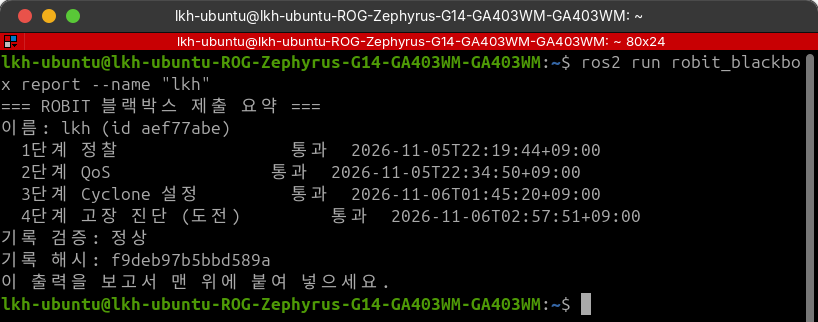
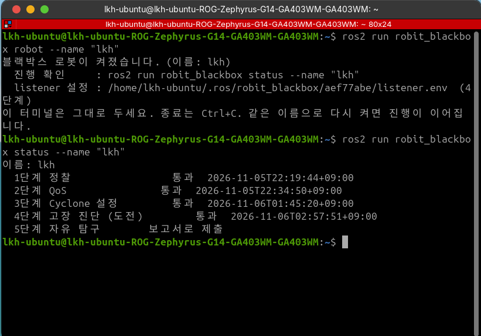
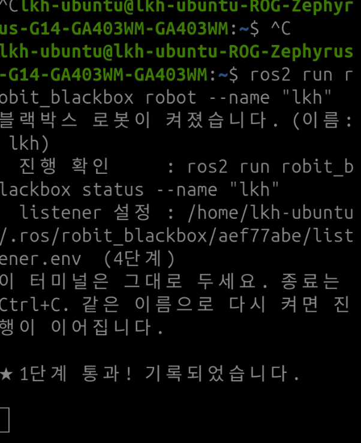
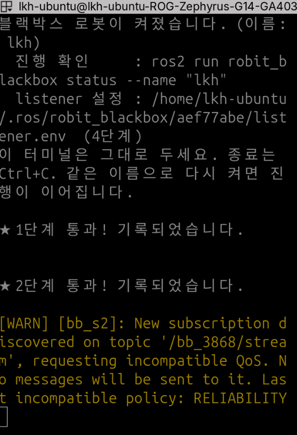
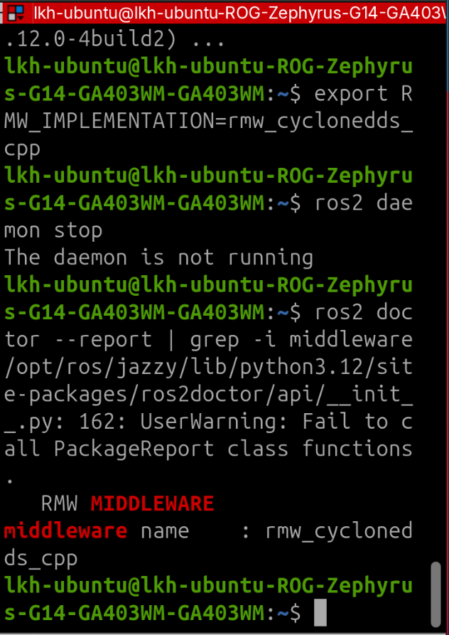
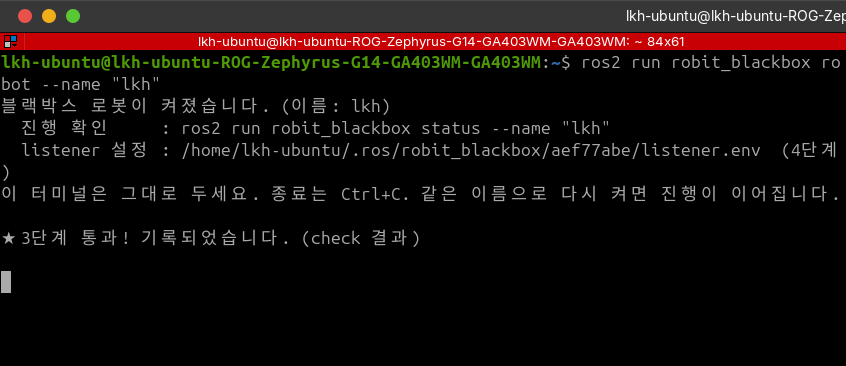
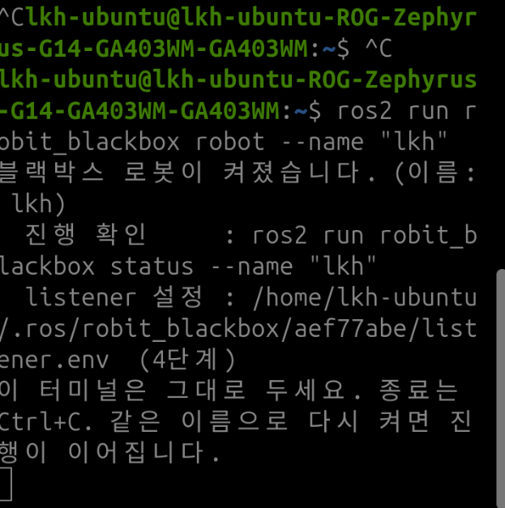

# 블랙박스 로봇 미션 보고서

> 학번: 2026406017 · 이름: 이규환 (Team RO:BIT 지능형로봇팀 21기, 로봇 이름 `lkh`)

```
=== ROBIT 블랙박스 제출 요약 ===
이름: lkh (id aef77abe)
  1단계 정찰                 통과  2026-11-05T22:19:44+09:00
  2단계 QoS                통과  2026-11-05T22:34:50+09:00
  3단계 Cyclone 설정         통과  2026-11-06T01:45:20+09:00
  4단계 고장 진단 (도전)         통과  2026-11-06T02:57:51+09:00
기록 검증: 정상
기록 해시: f9deb97b5bbd589a
```
+ 원본: [logs/final_report_output.txt](logs/final_report_output.txt)
+ 
+ 
+ 환경: Ubuntu 24.04, ROS 2 Jazzy, Fast DDS 2.14.7(기본), Cyclone DDS 0.10.5
+ 근거는 전부 내 PC에서 실행한 명령과 출력이다. 원문은 `logs/`, 사진은 `images/`에 있다.
+ 로봇의 소스, 프로세스, 상태 파일은 보지 않았다. 4단계 `listener.env`만 과제대로 열어서 고쳤다.

---

## 1단계: 정찰

### 과제 1
+ 도메인 10~95 중에서 로봇이 신호를 보내는 도메인과 토픽을 찾고, 챌린지 단어로 응답한다.
+ 결과: **통과** (2026-11-05 22:19:44)

### 스캔 스크립트
+ 처음에는 도메인만 바꿔 가며 `ros2 topic list`를 돌렸다 → 1분 20초가 걸렸고 신호를 놓쳤다.
  + 데몬이 도메인마다 새로 떠서 79개나 생겼고, 막 뜬 데몬은 발견이 끝나기 전에 답한다.
+ `--no-daemon`만 붙였더니 토픽이 하나도 안 나왔다.
  + 발견(SPDP→SEDP)을 기다리는 시간이 부족했다.
+ `--no-daemon --spin-time 4`로 바꾸고 15개씩 병렬로 돌리니 33초 만에 찾았다. ([hw1_scan.sh](../src/hw1_scan.sh))
```bash
for d in $(seq 10 95); do
  ROS_DOMAIN_ID=$d ros2 topic list --no-daemon --spin-time 4 | grep '^/bb_'   # 15개씩 병렬
done
```
```
domain 14  /bb_3868/cmd
domain 15  /bb_3868/command
domain 60  /bb_3868/ack
domain 60  /bb_3868/telemetry
domain 80  /bb_3868/answer
domain 80  /bb_3868/config
domain 80  /bb_3868/stream
domain 89  /bb_b7f2/config
```

### 신호 찾기
+ 타입 없이 echo했더니 `Could not determine the type`이 떴다. 타입을 직접 주니 됐다.
```bash
ROS_DOMAIN_ID=60 ros2 topic echo /bb_3868/telemetry std_msgs/msg/String --once
```
```
data: 'BB1 pos=(-0.88,0.64) | 챌린지: MARBLE-4845 | 이 단어를 그대로 /bb_3868/ack 로 보내라 | 다음 신호: 도메인 80'
```
+ `BB1`로 시작하고 챌린지와 응답 토픽이 있어서 이게 정찰 신호라고 판단했다.
+ 도메인 89의 `/bb_b7f2/config`는 접두사가 내 것(`bb_3868`)과 다르고, 다시 조회하니 사라져 있어서 제외했다.

### 응답
+ 로봇 구독자와 매칭되기 전에 보낸 메시지는 버려지므로, `-t 5 -r 1`로 매칭될 때까지 기다렸다가 5번 보내니 통과했다.
```bash
ROS_DOMAIN_ID=60 ros2 topic pub -t 5 -r 1 /bb_3868/ack std_msgs/msg/String "{data: 'MARBLE-4845'}"
```
+ 
+ 실행 기록: [s1_try1_scan_v1](logs/s1_try1_scan_v1.txt), [s1_try1_daemons](logs/s1_try1_daemons.txt), [s1_try2_scan_v2](logs/s1_try2_scan_v2.txt), [s1_try3_scan_final](logs/s1_try3_scan_final.txt), [s1_try4_signal](logs/s1_try4_signal.txt), [s1_final_reply](logs/s1_final_reply.txt)

---

## 2단계: QoS

### 과제 2
+ 도메인 80의 두 토픽(config, stream) 값을 직접 만든 구독 노드로 받아서 응답한다.
+ 결과: **통과** (2026-11-05 22:34:50), 한 번에 통과했다.

### 발행자 QoS 확인
```bash
ROS_DOMAIN_ID=80 ros2 topic info -v /bb_3868/config --no-daemon --spin-time 4
ROS_DOMAIN_ID=80 ros2 topic info -v /bb_3868/stream --no-daemon --spin-time 4
```
```
/bb_3868/config   PUBLISHER   Reliability: RELIABLE      Durability: TRANSIENT_LOCAL
/bb_3868/stream   PUBLISHER   Reliability: BEST_EFFORT   Durability: VOLATILE
```

### 구독 노드 ([hw2_bb_sub.py](../src/hw2_bb_sub.py))
+ config는 RELIABLE + TRANSIENT_LOCAL, stream은 BEST_EFFORT로 맞췄다.
```python
CONFIG_QOS = QoSProfile(reliability=RELIABLE,    durability=TRANSIENT_LOCAL, history=KEEP_LAST, depth=1)
STREAM_QOS = QoSProfile(reliability=BEST_EFFORT, durability=VOLATILE,        history=KEEP_LAST, depth=10)
```
```bash
ROS_DOMAIN_ID=80 python3 src/hw2_bb_sub.py
```
```
[config] BB2-A word=4513 | … A-B 순서로 "-" 로 이어 /bb_3868/answer 로 보내라 … | 다음 신호: 도메인 14의 /bb_3868/cmd
[stream] BB2-B word=a2a9 n=11917
```
+ 노드를 켜 둔 채로 응답했다.
```bash
ROS_DOMAIN_ID=80 ros2 topic pub -t 5 -r 1 /bb_3868/answer std_msgs/msg/String "{data: '4513-a2a9'}"
```

### 기본 설정으로는 왜 안 되나
+ 통과한 뒤에 기본 QoS(RELIABLE + VOLATILE)로 10초 동안 구독해 봤다.
```
[WARN] … '/bb_3868/stream', offering incompatible QoS. … Last incompatible policy: RELIABILITY
10초 동안 받은 메시지 수: config=0, stream=0
```
+ stream: 발행자는 BEST_EFFORT인데 구독자가 RELIABLE을 요구해서 매칭이 안 됐다(제공 ≥ 요구여야 한다).
+ config: 경고는 없지만 0개다. VOLATILE 구독자는 접속하기 전에 나간 값을 못 받는다.
+ 로봇 터미널(발행자 쪽)에도 `[bb_s2]: New subscription discovered … requesting incompatible QoS` 경고가 떴다.
+ 
+ 실행 기록: [s2_01_info](logs/s2_01_info.txt), [s2_02_bb_sub](logs/s2_02_bb_sub.log), [s2_03_answer](logs/s2_03_answer.txt), [s2_04_default_qos](logs/s2_04_default_qos.txt)

---

## 3단계: Cyclone 설정

### 과제 3
+ check3가 준 요구사항대로 `~/cyclonedds_bb.xml`을 작성한다.
+ 결과: **통과** (2026-11-06 01:45:20)

### Cyclone DDS 설치 확인
+ 기본 RMW는 Fast DDS라서 Cyclone DDS를 설치하고 바꿔서 테스트해 봤다.
```bash
sudo apt install ros-jazzy-rmw-cyclonedds-cpp
export RMW_IMPLEMENTATION=rmw_cyclonedds_cpp
ros2 doctor --report | grep middleware
```
```
middleware name    : rmw_cyclonedds_cpp
```
+ Cyclone으로 간단하게 pub/sub 해 봤더니 잘 받아졌다.
```bash
ros2 topic pub -r 1 /cyclone_test std_msgs/msg/String "{data: 'hello cyclone'}"   # 터미널 1
ros2 topic echo /cyclone_test --once                                               # 터미널 2
```
```
data: hello cyclone
---
```
+ 
+ 실행 기록: [s3_00_cyclone_pubsub](logs/s3_00_cyclone_pubsub.txt)

### 요구사항
```bash
ros2 run robit_blackbox check3 --name lkh
```
```
- 검사는 ROS_DOMAIN_ID=63 에서 실행된다
- Peers 에 127.0.0.1 이 있다
- AllowMulticast 는 false 또는 spdp
- MaxAutoParticipantIndex 는 10
- Tracing 의 Verbosity 를 지정하고 OutputFile 은 /tmp/bb3_aef77abe.log
```
+ XML이 없어서 처음엔 `설정 파일이 없습니다`가 떴다.

### XML 작성
+ 처음에는 요구사항 항목을 전부 `General` 아래에 넣었다.
  + check3 구조 점검은 다 OK인데 통신 테스트가 NG였다.
  + 같은 XML로 Cyclone을 직접 띄워 보니 `General: Peers: unknown element` → `failed to create domain`이 떴다. 위치가 틀리면 설정 전체를 거부한다.
+ 공식 문서대로 `Peers`, `MaxAutoParticipantIndex`를 `Discovery` 아래로 옮기니 통과했다. ([hw3_cyclonedds_bb.xml](../src/hw3_cyclonedds_bb.xml))
```xml
<CycloneDDS xmlns="https://cdds.io/config">
  <Domain id="any">
    <General><AllowMulticast>false</AllowMulticast></General>
    <Discovery>
      <Peers><Peer address="127.0.0.1"/></Peers>
      <MaxAutoParticipantIndex>10</MaxAutoParticipantIndex>
    </Discovery>
    <Tracing>
      <Verbosity>config</Verbosity>
      <OutputFile>/tmp/bb3_aef77abe.log</OutputFile>
    </Tracing>
  </Domain>
</CycloneDDS>
```
+ 

### Tracing 로그 근거
```
24: config: Domain/Discovery/Peers/Peer[@Address]: 127.0.0.1 {2}
42: selected interfaces: wlp99s0 (index 2 priority 0)
53: add_peer_addresses: add udp/127.0.0.1:23160, :23162, … , :23178
```
+ 24줄: 내 XML의 Peer가 실제로 읽혔다.
+ 42줄: 인터페이스는 `wlp99s0`(Wi-Fi)가 선택됐다.
+ 53줄: 멀티캐스트가 없으니 127.0.0.1의 포트 10개로 SPDP를 보낸다. 7400 + 250×63 + 10 + 2i(i=0~9) = 23160~23178로 계산과 같다.
+ `ParticipantIndex`는 안 적었는데 로그에 `auto {0}`(기본값)으로 나왔다. 그래서 없어도 됐다.
+ 실행 기록: [s3_try1_no_xml](logs/s3_try1_no_xml.txt), [s3_try2_wrong_location](logs/s3_try2_wrong_location.txt), [s3_try3](logs/s3_try3_no_participant_index.txt), [s3_trace_evidence](logs/s3_trace_evidence.txt), [s3_status](logs/s3_status.txt), [Tracing 전체 로그](logs/s3_bb3_trace_full.log)

---

## 4단계: 고장 진단

### 과제 4
+ 로봇의 listener가 talker 신호를 못 받고 있다. `listener.env`의 틀린 값을 CLI로 찾아서 고친다.
+ 결과: **통과** (2026-11-06 02:57:51), 틀린 값은 2개(DOMAIN, TOPIC)였다.
+ 2단계 신호에 "다음 신호: 도메인 14의 `/bb_3868/cmd`"가 있었다.

### 고치기 전
```
LISTENER_DOMAIN=15
LISTENER_TOPIC=/bb_3868/command
LISTENER_TYPE=Int32
LISTENER_RELIABILITY=best_effort
```
+ 

### talker 조사
```bash
ROS_DOMAIN_ID=14 ros2 topic list -t --no-daemon --spin-time 4
ROS_DOMAIN_ID=14 ros2 topic info -v /bb_3868/cmd --no-daemon --spin-time 4
```
+ 데이터를 보려고 `String`으로 echo했더니 아무것도 안 왔다. 타입이 다르면 오류 없이 조용히 안 받아진다. `Int32`로 하니 `data: 8661`이 왔다.

### 증거 표
| 항목 | talker 값 | listener 값 | 증명 명령 | 출력 |
|---|---|---|---|---|
| DOMAIN | **14** | **15** ❌ | `ROS_DOMAIN_ID=14 ros2 topic list -t` | `/bb_3868/cmd [std_msgs/msg/Int32]` (도메인 15에는 발행자 없음: `Publisher count: 0`) |
| TOPIC | **/bb_3868/cmd** | **/bb_3868/command** ❌ | `ros2 topic info -v /bb_3868/cmd` | `Publisher count: 1` / `Node name: bb_talker4` |
| TYPE | Int32 | Int32 ✅ | `ros2 topic info -v /bb_3868/cmd` | `Type: std_msgs/msg/Int32` |
| RELIABILITY | BEST_EFFORT | best_effort ✅ | `ros2 topic info -v /bb_3868/cmd` | `Reliability: BEST_EFFORT` |

### 고치기 (하나씩)
+ DOMAIN 15 → 14만 먼저 고쳤다. 도메인 14에 `/bb_3868/cmd`와 `/bb_3868/command`가 둘 다 보이는데 `Subscription count: 0`이었다.
  + 도메인이 틀리면 포트가 달라서 **서로를 못 찾는다**(발견 실패).
+ TOPIC `/bb_3868/command` → `/bb_3868/cmd`를 고치니 Publisher 1개, Subscription 1개가 매칭되고 통과했다.
  + 같은 도메인에서 서로 보이는데 이름이 달라서 **찾았지만 짝지어지지 않았다**(매칭 실패).
+ `ros2 run robit_blackbox status --name lkh`로 1~4단계 통과를 확인했다.
+ 
+ 실행 기록: [s4_01_listener_before](logs/s4_01_listener_before.txt), [listener.env 원본](logs/s4_listener.env.orig), [s4_02_talker](logs/s4_02_talker.txt), [s4_03_fix1_domain](logs/s4_03_fix1_domain.txt), [s4_04_fix2_topic](logs/s4_04_fix2_topic.txt)

---

## 5단계: 자유 탐구

### 질문
+ Fast DDS와 Cyclone DDS는 같은 도메인에서 서로 통신하는가? 안 된다면 어떤 조건에서 안 되는가?
+ 예상: 둘 다 RTPS 표준이라 될 것 같다. 멀티캐스트를 끄면 안 될 것 같다.

### 실험 방법
+ 도메인 43에서 `demo_nodes_cpp` talker/listener를 RMW 조합별로 띄우고, listener가 10초 동안 받은 메시지 수를 셌다.
```bash
ROS_DOMAIN_ID=43 RMW_IMPLEMENTATION=rmw_fastrtps_cpp  ros2 run demo_nodes_cpp talker              # 터미널 1
ROS_DOMAIN_ID=43 RMW_IMPLEMENTATION=rmw_cyclonedds_cpp timeout 10 ros2 run demo_nodes_cpp listener # 터미널 2
```
+ listener 쪽에만 Cyclone XML을 줘서 조건을 바꿨다(`CYCLONEDDS_URI=file://...`).
  + 조건 A: `AllowMulticast=false`, Peers 없음
  + 조건 B: `AllowMulticast=false` + `Peer 127.0.0.1` + `MaxAutoParticipantIndex 10`

### 결과
| talker → listener | listener 조건 | 받은 수 |
|---|---|---|
| Fast → Fast / Cyclone → Cyclone | 기본 | 9 / 9 |
| **Fast → Cyclone / Cyclone → Fast** | 기본 | **8 / 9** |
| Cyclone → Cyclone / Fast → Cyclone | 멀티캐스트 끔, Peers 없음 | **0 / 0** |
| Cyclone → Cyclone / **Fast → Cyclone** | 멀티캐스트 끔 + Peer 127.0.0.1 | 9 / **8** |

+ Fast talker가 연 포트를 보니 `18160`이 있었다. 7400 + 250×43 + 10과 같고, Cyclone이 Peer로 SPDP를 보내는 포트(18160 + 2i)에 들어간다.

### 결론
+ 같은 도메인이면 Fast DDS와 Cyclone DDS는 양방향으로 통신된다.
+ 안 되는 건 구현이 달라서가 아니라 발견(SPDP)이 막혀서다.
+ 멀티캐스트를 꺼도 Peer만 주면 다른 구현과도 통신된다.

### 예상과 달랐던 점
+ 처음에 Peer를 준 조건이 Cyclone끼리도 0개가 나와서 이상했다.
  + 원인은 내 스크립트였다. `${X:+NAME=값}`을 명령 앞에 쓰면 bash가 환경변수가 아니라 명령 이름으로 읽어서 listener가 아예 안 떴다(`FOO=bar: command not found`로 재현).
  + `env`로 고쳐서 다시 쟀다. 위 표는 고친 뒤의 결과다.
+ Fast DDS 쪽에 아무 설정도 안 했는데, Cyclone이 유니캐스트로 보낸 SPDP에 응답한 것도 예상 밖이었다.
+ 실행 기록: [s5_01_interop_matrix](logs/s5_01_interop_matrix.txt), [s5_06_interop_discovery](logs/s5_06_interop_discovery.txt), [s5_07_fast_port](logs/s5_07_fast_port.txt), [버그 재현 s5_05](logs/s5_05_script_bug.txt), 버그 있던 측정 [s5_02](logs/s5_02_INVALID_script_bug.txt), [s5_03](logs/s5_03_INVALID_script_bug.txt)

---

## 아직 이해 못 한 것
+ Fast DDS끼리는 같은 PC에서 공유 메모리(SHM)를 쓴다는데, 상대가 Cyclone이면 UDP로 바뀌는 건지, 그걸 어떻게 확인하는지 아직 모르겠다.

## 제출 소스
+ 1단계 스캔 스크립트: [src/hw1_scan.sh](../src/hw1_scan.sh)
+ 2단계 구독 노드: [src/hw2_bb_sub.py](../src/hw2_bb_sub.py)
+ 3단계 XML: [src/hw3_cyclonedds_bb.xml](../src/hw3_cyclonedds_bb.xml)
