# Day4 Fast DDS와 Cyclone DDS 지연 실험

이규환 2026406017

---

## 1. 질문

day_3 5단계에서 같은 도메인이면 Fast DDS와 Cyclone DDS가 서로 통신된다는 걸 확인했는데, 받은 메시지 개수만 봤다. 그리고 "아직 이해 못 한 것"에 Fast DDS끼리는 같은 PC에서 공유 메모리(SHM)를 쓴다는데 상대가 Cyclone이면 UDP로 바뀌는지, 그걸 어떻게 확인하는지 모르겠다고 적었다. 이번에 그걸 직접 확인해 봤다.

+ Fast DDS끼리는 SHM을 쓰고, Cyclone이 끼면 UDP로 바뀌나?
+ PC가 두 대로 나뉘면 어떻게 되나?
+ 그때 지연은 얼마나 달라지나?

+ 환경: Ubuntu 24.04, ROS 2 Jazzy, Fast DDS 2.14.7(기본), Cyclone DDS 0.10.5 (day_3과 같음), 내 노트북 + 친구 PC (같은 와이파이)
+ 기본적인 자료 정리, 결과 분석, 소스 파일 작성에 Claude(AI)의 도움을 받았다.

## 2. 예상

+ 같은 PC에서 `lo`에 지연을 걸면, UDP는 `lo`를 지나니까 느려지고 SHM은 안 지나니까 그대로일 것이다. → Fast ↔ Fast만 그대로, 나머지는 왕복 40ms 정도 늘 것이다.
+ PC가 나뉘면 SHM을 못 쓰니까 Fast ↔ Fast도 느려질 것이다.
+ 손실을 걸어도 reliable이라 메시지는 다 오고, 대신 가끔 늦게 오는 게 생길 것이다.

## 3. 방법

### 3.1 측정 방법

+ `ping.py`가 0.05초마다 메시지를 보내고 `pong.py`가 그대로 돌려보내서 왕복 시간(RTT)을 쟀다.
+ ping이 보낸 시험 메시지가 돌아온 뒤(= 양쪽이 다 매칭된 뒤)부터 쟀다. 결과의 `connect`가 여기까지 걸린 시간이다.
+ 처음 10개는 빼고 100개를 쟀고, 3번씩 해서 조건마다 300개다.
+ `RMW_IMPLEMENTATION`으로 Fast, Cyclone을 바꿨다. Fast → Cyclone은 ping이 Fast, pong이 Cyclone이다.
+ 메시지에 `x`를 200개 붙이고, `sniff.py`로 그게 보이는 UDP 패킷을 셌다. 메시지가 UDP로 가면 여기서 보이고, SHM으로 가면 안 보인다.

### 3.2 PC 한 대

+ `lo`에만 지연을 걸려고 네트워크 네임스페이스를 따로 만들어서 그 안에서 돌렸다(`netns.sh`). 끝나면 지연도 같이 사라져서 `tc qdisc del`을 따로 안 해도 된다.
+ day_3 Tracing 로그에서는 Cyclone이 `wlp99s0`을 골랐는데, 이 네임스페이스 안에는 `lo`밖에 없어서 UDP는 전부 `lo`로 지나간다.
+ Fast ↔ Fast에 `FASTDDS_BUILTIN_TRANSPORTS=UDPv4`를 줘서 UDP만 쓰게 한 것도 같이 쟀다.
```bash
cd day_4/src
./run_matrix.sh                          # 전체 측정 (약 6분)
./netns.sh 20 ./one_run.sh fast fast     # 지연 20ms, Fast ↔ Fast 1번
./packet_count.sh                        # 패킷 세기 (약 1분)
```
+ 처음에 일반 터미널에서는 `unshare: write failed /proc/self/uid_map: Operation not permitted`가 떴다. Ubuntu 24.04가 막아 둔 거라서 sudo로 만들게 고쳤다. 표의 측정은 내 터미널에서 돌렸다.

### 3.3 PC 두 대

+ 친구 PC(192.168.0.15)에는 `friend_pong.sh` 파일 하나만 보내서 실행해 달라고 했다. 도메인 45에 Fast pong, 46에 Cyclone pong을 띄워 둔다.
+ 내 노트북(192.168.0.161, `wlp99s0`)에서 도메인만 바꿔 가며 쟀다. 시간은 내 노트북 시계로만 재니까 두 PC 시계를 맞출 필요가 없다.
+ 조건은 그냥, `netem delay 20ms`, `netem loss 5%` 세 가지다. 노트북 와이파이에 걸었고 끝나면 스크립트가 해제한다.
```bash
bash friend_pong.sh                    # 친구 PC
./two_pc_check.sh 192.168.0.15         # 노트북, 연결 확인
./two_pc_run.sh wlp99s0 192.168.0.15   # 노트북, 측정
```
+ 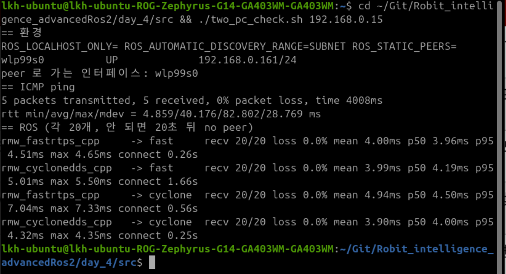

## 4. 결과

### 4.1 PC 한 대

+ 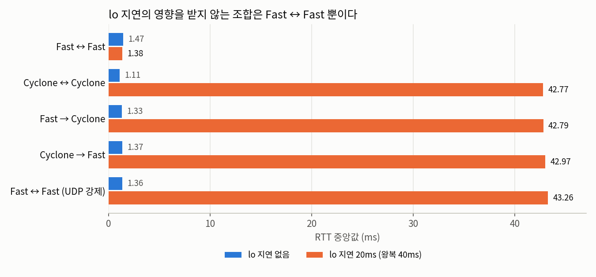
+ 지연 20ms를 걸어도 Fast ↔ Fast만 1~2ms 정도로 그대로였다. 나머지는 43ms 정도가 됐다.
+ UDP만 쓰게 한 Fast ↔ Fast도 43ms 정도가 됐다.

| 조합 | 지연 없음 | 지연 20ms |
|---|---|---|
| Fast ↔ Fast | 1.47ms | **1.38ms** |
| Cyclone ↔ Cyclone | 1.11ms | 42.77ms |
| Fast → Cyclone | 1.33ms | 42.79ms |
| Cyclone → Fast | 1.37ms | 42.97ms |
| Fast ↔ Fast (UDP만) | 1.36ms | **43.26ms** |

+ 값은 중간값(p50)이다. 300개 다 받았고 손실은 없었다. 평균, p95까지 다 있는 표는 [s4_summary](logs/s4_summary.txt)에 있다.
+ 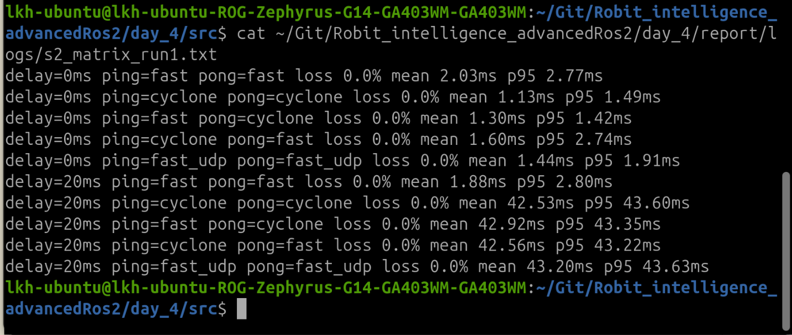

패킷 수 (지연 없음, 110개 왕복)
+ Fast ↔ Fast만 메시지가 UDP에 한 번도 안 보였다. 나머지는 220개(110개 × 왕복)가 다 보였다.
```
fast fast        UDP 패킷 전체: 117 / 페이로드가 보인 패킷: 0
fast cyclone     UDP 패킷 전체: 423 / 페이로드가 보인 패킷: 220
cyclone fast     UDP 패킷 전체: 461 / 페이로드가 보인 패킷: 220
cyclone cyclone  UDP 패킷 전체: 364 / 페이로드가 보인 패킷: 220
fast(UDP만) fast UDP 패킷 전체: 446 / 페이로드가 보인 패킷: 220
```
+ 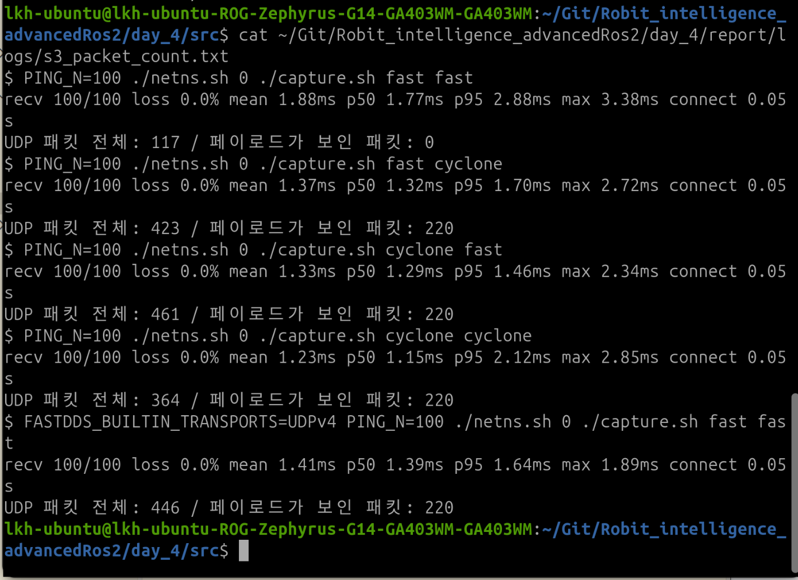

### 4.2 PC 두 대

+ 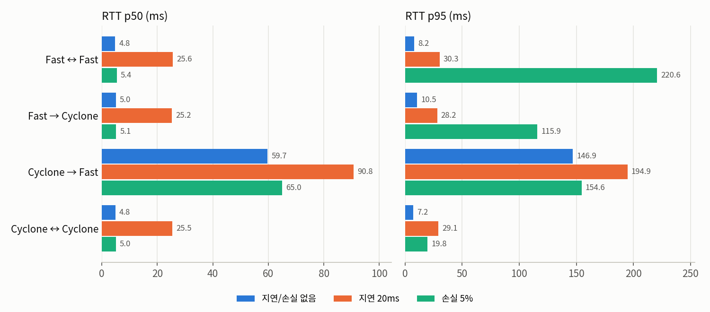
+ 이번에는 Fast ↔ Fast도 지연을 걸면 4.81ms → 25.57ms로 20ms 정도 늘었다.
+ 손실 5%에서도 메시지는 다 왔다. 중간값은 거의 그대로인데 p95가 커졌다.

| 조합 | 그냥 | 지연 20ms | 손실 5% (p95) |
|---|---|---|---|
| Fast ↔ Fast | 4.81ms | 25.57ms | 220.64ms |
| Fast → Cyclone | 5.04ms | 25.23ms | 115.94ms |
| Cyclone → Fast | **59.71ms** | **90.81ms** | 154.57ms |
| Cyclone ↔ Cyclone | 4.84ms | 25.45ms | 19.77ms |

+ 앞 두 칸은 중간값(p50)이다. 모든 조건에서 300개씩 다 받았다(손실 0). 전체 표는 [s6_two_pc_summary](logs/s6_two_pc_summary.txt)에 있다.
+ 그런데 Cyclone → Fast만 이상하게 느렸다. 회차별로 보니 1회차는 다른 조합과 비슷한데 2, 3회차만 90ms 정도 더 느렸다. 세 조건 다 그랬다.
+ 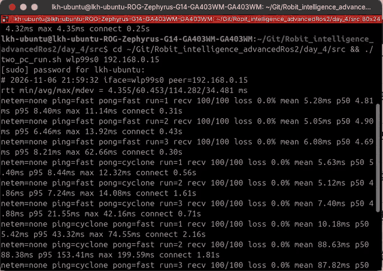
+ 원본 영상: [two_pc_run.mp4](video/two_pc_run.mp4) (녹화 뒷부분 화면이 깨져서 앞부분만 잘랐다)
+ 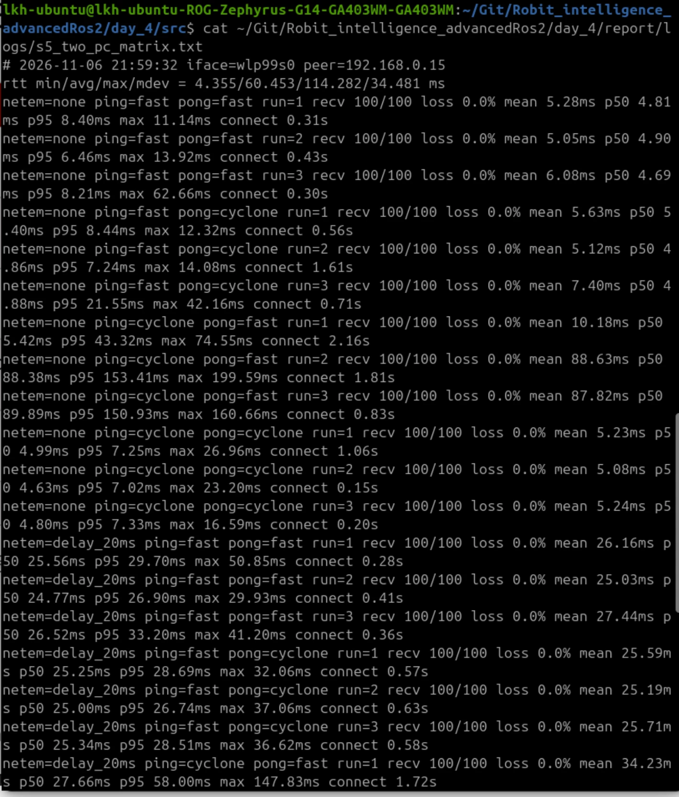
+ 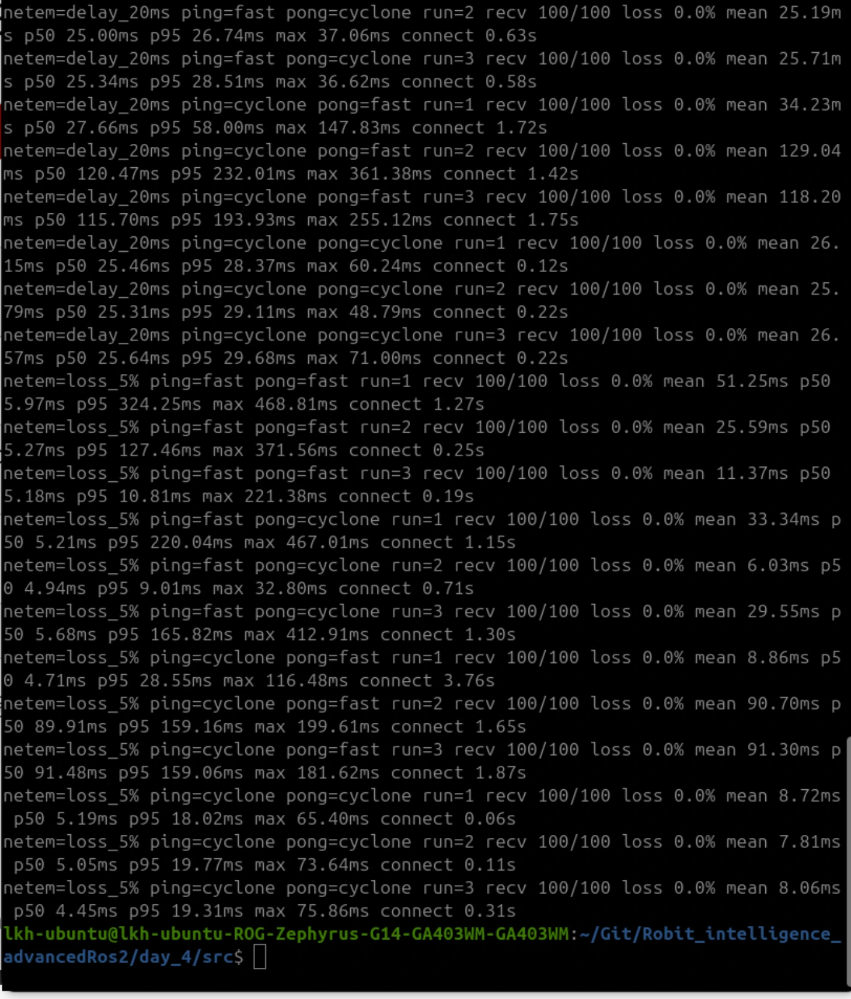

### 4.3 Cyclone → Fast 다시 재기

+ 1회차만 괜찮으니까, 앞에서 끝난 ping이 발견으로 알려 둔 정보가 친구 PC에 잠깐 남아 있어서 그런 것 같았다.
+ 친구 PC의 pong을 다시 켜고, 실행 사이 간격을 0초, 15초, 60초로 바꿔 가며 쟀다. 이번에는 패킷이 유니캐스트로 오는지 멀티캐스트로 오는지도 셌다.
```bash
./retest.sh wlp99s0 192.168.0.15
```
```
gap=0s  run=1  p50 5.85ms  | in_uni=110 in_multi=0
gap=0s  run=2  p50 87.54ms | in_uni=0   in_multi=110
gap=0s  run=3  p50 90.54ms | in_uni=0   in_multi=110
gap=0s  run=4  p50 85.73ms | in_uni=1   in_multi=109
gap=15s run=1  p50 5.07ms  | in_uni=110 in_multi=0
gap=15s run=2  p50 4.71ms  | in_uni=110 in_multi=0
gap=15s run=3  p50 5.05ms  | in_uni=110 in_multi=0
gap=60s run=1  p50 4.54ms  | in_uni=110 in_multi=0
gap=60s run=2  p50 4.72ms  | in_uni=110 in_multi=0
gap=60s run=3  p50 5.73ms  | in_uni=110 in_multi=0
```
+ 간격 없이 바로 다시 돌렸을 때만 친구 PC에서 오는 메시지가 멀티캐스트로 왔고, 그때만 90ms 정도로 느렸다.
+ 15초 이상 기다리면 다시 유니캐스트로 왔고 5ms 정도였다.
+ 내 노트북에서 나가는 쪽은 항상 유니캐스트였다.
+ 나머지 조합은 9번 다 유니캐스트였고 5ms 정도였다. Fast ↔ Fast도 메시지가 UDP에 110개씩 보여서, PC가 나뉘면 Fast끼리도 UDP를 쓰는 게 맞았다.
+ 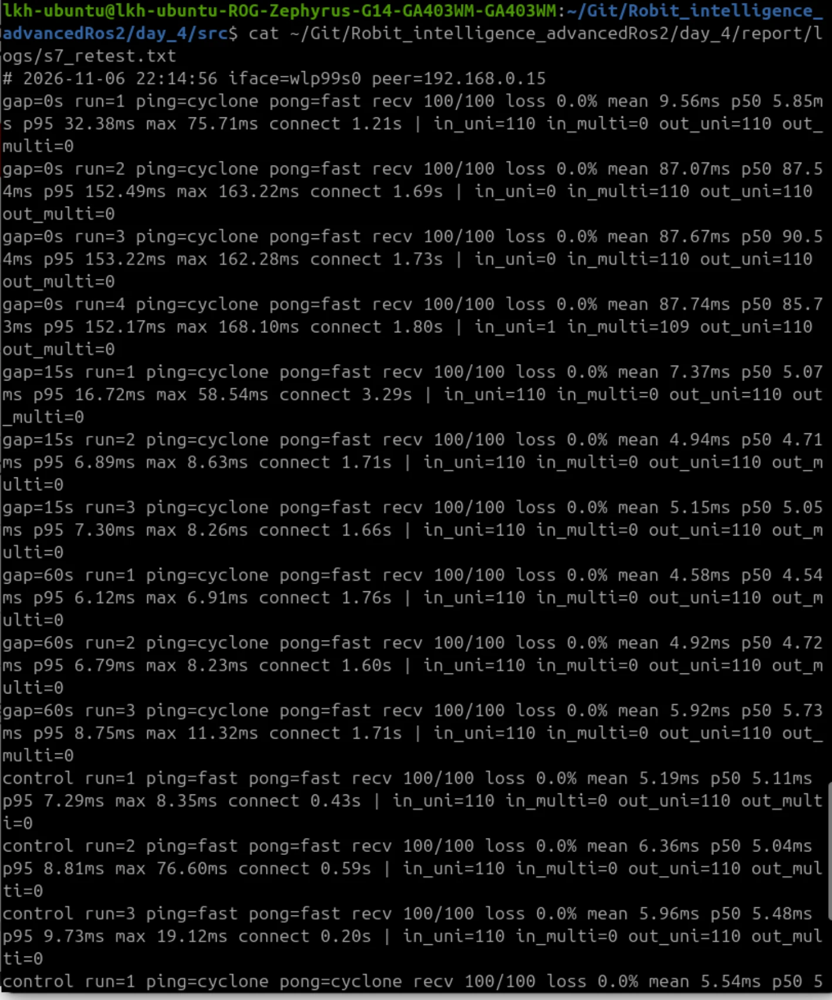
+ 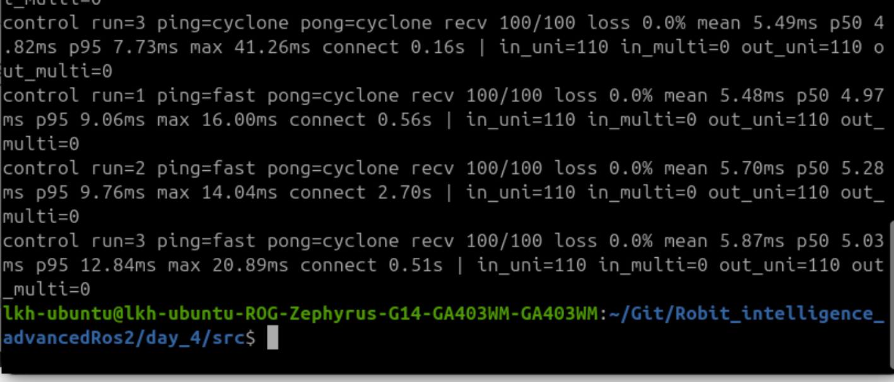
+ 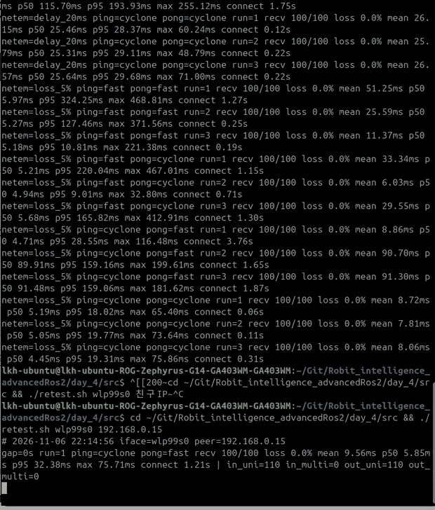
+ 원본 영상: [retest_run.mp4](video/retest_run.mp4)

## 5. 결론

+ 같은 PC에서 Fast DDS끼리는 UDP를 안 쓴다. 지연을 걸어도 안 느려졌고, UDP 패킷에 메시지가 안 보였고, UDP만 쓰게 하면 똑같이 느려졌다. 그래서 SHM을 쓴다고 판단했다.
+ 상대가 Cyclone이면 Fast DDS도 UDP를 쓴다.
+ PC가 나뉘면 Fast끼리도 UDP를 쓴다.
+ 손실이 있어도 reliable이라 메시지는 다 오고, 대신 몇 개가 많이 늦게 온다.
+ 예상은 다 맞았다.
+ Cyclone → Fast를 바로바로 다시 돌리면 메시지가 멀티캐스트로 바뀌면서 90ms 정도로 느려졌다. 그래서 4.2 표의 Cyclone → Fast 값은 원래 성능이 아니고, 원래는 다른 조합처럼 5ms 정도다.

## 6. 예상과 달랐던 점

+ Cyclone → Fast가 느려지는 건 전혀 예상 못 했다. 다시 재 보니 멀티캐스트와 같이 나타났다.
+ SHM이 UDP보다 빠를 줄 알았는데 지연이 없을 때는 차이가 거의 없었다(SHM 1.47ms, UDP 1.36ms). 메시지가 작아서 그런 것 같은데 확인은 안 했다.
+ 손실 5%에서 Cyclone ↔ Cyclone(19.77ms)보다 Fast ↔ Fast(220.64ms)의 p95가 훨씬 컸다. 그런데 Fast ↔ Fast는 회차마다 10.81ms ~ 324.25ms로 들쭉날쭉해서 3번만 보고는 뭐가 더 낫다고 말하기 어렵다.
+ 그냥 `ping` 명령은 평균 40~60ms로 ROS 측정(5ms)보다 오히려 느렸다. 왜 그런지는 모르겠다.
+ 처음 시험에서 `recv 12/20 loss 40.0%`가 나왔다. day_3 1단계에서 겪은 것처럼 매칭되기 전에 보낸 메시지가 버려진 거였다. ping 쪽 구독자 수만 확인하고 보냈는데, pong이 돌려보내는 쪽은 아직 매칭 전이었다. 시험 메시지가 한 번 돌아온 뒤에 재도록 고치고 다시 쟀다. ([s1_try1](logs/s1_try1_INVALID_connect_check.txt))
  + 이번에 Fast와 Cyclone을 섞으면 매칭이 오래 걸릴 때가 있었다(PC 한 대에서 0.95초, PC 두 대에서 최대 3.76초). 그래서 day_3 5단계에서 9개, 8개 차이 났던 것도 손실이 아니라 매칭이 늦어서였을 것 같다. 8개였던 쪽은 첫 메시지가 `Hello World: 4`였다.
+ `tcpdump`로 패킷을 세려고 했는데 Ubuntu 보안 설정(AppArmor) 때문에 끄지를 못해서 `sniff.py`를 따로 만들었다. ([s1_try2](logs/s1_try2_tcpdump_blocked.txt))

## 7. 한계

+ 메시지가 작아서 큰 메시지일 때는 모른다.
+ 조건마다 3번씩만 쟀고, 같은 조합을 연달아 돌렸다. 실제로 이 순서 때문에 Cyclone → Fast 값이 나빠졌다.
+ 지연, 손실은 내 노트북에서 나가는 쪽에만 걸었고, 패킷도 내 노트북에서만 셌다.
+ 친구 PC 사양이나 설정은 기록 못 했다.

## 8. 아직 이해 못 한 것

+ 왜 Cyclone ping이 끝나고 바로 다시 켜면 Fast pong이 멀티캐스트로 보내는지, 왜 Fast → Fast에서는 안 그러는지 모르겠다. 와이파이에서 멀티캐스트가 왜 90ms나 걸리는지도 모르겠다.
+ PC 한 대에서 Fast와 Cyclone을 섞으면 지연이 없을 때 매칭까지 1초 가까이 걸릴 때가 있었다(`connect 0.95s`, 6번 중 2번). 왜 1초 가까이 걸리는지 모르겠다.

## 9. 제출 소스

+ 측정: [ping.py](../src/ping.py), [pong.py](../src/pong.py), [one_run.sh](../src/one_run.sh), [run_matrix.sh](../src/run_matrix.sh), [packet_count.sh](../src/packet_count.sh)
+ 지연, 패킷 세기: [netns.sh](../src/netns.sh), [capture.sh](../src/capture.sh), [sniff.py](../src/sniff.py)
+ 두 PC: [friend_pong.sh](../src/friend_pong.sh), [two_pc_check.sh](../src/two_pc_check.sh), [two_pc_run.sh](../src/two_pc_run.sh), [retest.sh](../src/retest.sh)
+ 정리: [summarize.py](../src/summarize.py), [summarize_two_pc.py](../src/summarize_two_pc.py)
+ 실행 기록: [s2_matrix](logs/s2_matrix.txt), [s3_packet_count](logs/s3_packet_count.txt), [s4_summary](logs/s4_summary.txt), [s5_two_pc_matrix](logs/s5_two_pc_matrix.txt), [s6_two_pc_summary](logs/s6_two_pc_summary.txt), [s7_retest](logs/s7_retest.txt), 측정값 원본 `logs/raw/`, `logs/raw_two_pc/`
