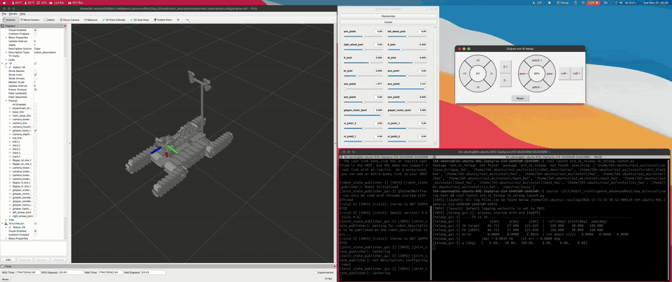

# Day6 IK

이규환 2026406017

---

## DH 파라미터

`eclipse_arm.xacro`, `eclipse.xacro`의 arm_joint1~6 `origin xyz`, `axis`를 보고 수정했다.

+ 축 방향 z → y → y → z → y → z 로 α를 정함
+ y 오프셋(±0.07, ±0.027)은 서로 상쇄돼서 무시
+ joint2→3 (0.026857, 0, 0.416012) → a₂ = 0.416878, 기울기 φ = 3.694°
+ joint3→4 x 0.027172 → a₃, z 0.362527 + joint4→5 z 0.0602 → d₄
+ joint1→2 z 0.033 → d₁, joint5→6 z 0.053 → d₆
+ θ = 0을 접힌 자세로 잡음

| i | d [m] | θ offset | a [m] | α |
|:-:|:-:|:-:|:-:|:-:|
| 1 | 0.033 | 0° | 0 | -90° |
| 2 | 0 | -176.306° | 0.416878 | 0° |
| 3 | 0 | 86.306° | 0.027172 | -90° |
| 4 | 0.422727 | 0° | 0 | 90° |
| 5 | 0 | 0° | 0 | -90° |
| 6 | 0.053 | 180° | 0 | 0° |

+ base → joint1: (0.027, 0.027, 0.138)
+ Q_SHIFT = (0°, -90°, 180°, 0°, 0°, 0°)

## IK (해석적 풀이)

수업에서 배운 "6축 로봇도 같은 아이디어"(앞 3축 → 위치, 뒤 3축 → 방향)대로 했다. `ik_core.py`의 `ik_all()`, `solve_ik()`

+ **조건 확인**: DH 표에서 a₄ = a₅ = d₅ = 0 → 마지막 세 축이 한 점에서 만난다 (Pieper 조건)
+ **손목점**: P_w = P₆ − d₆·R·[0 0 1]ᵀ
+ **θ₁**: 위에서 본 손목점 방향 atan2(y_w, x_w). 뒤로 넘기는 경우(+180°)도 있다.
+ **θ₂, θ₃**: joint2 → 손목점을 2링크 문제로 봤다. L₁ = a₂, L₂ = √(a₃² + d₄²) (link3가 a₃, d₄로 꺾여 있어서 하나로 묶음)
  + c = (x² + y² − L₁² − L₂²) / (2L₁L₂), |c| > 1이면 해 없음
  + s = ±√(1 − c²) → 팔꿈치 위/아래 두 자세
  + θ₂ = atan2(y, x) − atan2(L₂s, L₁ + L₂c),  θ₃ = atan2(s, c) − (link3 꺾인 각)
+ **θ₄~θ₆**: 남은 방향 R₃⁶ = R₀³ᵀ·R. DH 표대로 곱하면 Rz(θ₄)·Ry(−θ₅)·Rz(θ₆)라서 ZYZ 오일러각으로 풀었다. 손목 뒤집기로 2가지.
+ **해 고르기**: 2 × 2 × 2 = 최대 8개 중 관절 한계 안에 있고 **현재 자세와 가장 가까운 것**을 고른다. 해가 없으면 그 이동은 무시한다.

## 결과

